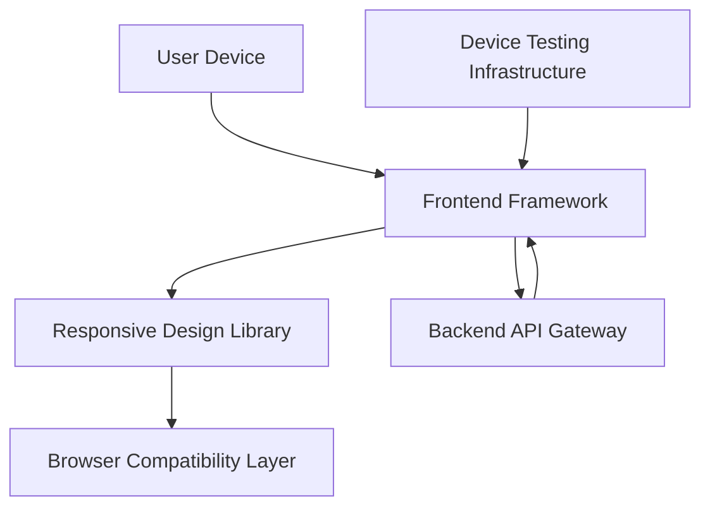

#### 1. High-Level Design

- **Summary:** This epic delivers a modern, responsive user interface that provides seamless user experience across all devices and screen sizes (desktop, tablet, mobile). The interface ensures consistent functionality and optimized layouts for credit card dashboard, transactions, and analytics visualizations, adapting to screen resolutions from 320px to 4K while maintaining usability and visual appeal.

- **Component Flow:**

- **Integration Points:**
  - **Upstream:** Backend API Gateway (provides data for dashboard, transactions, and analytics)
  - **Internal:** Frontend Framework (manages application state and rendering), Responsive Design Library (provides adaptive UI components), Browser Compatibility Layer (ensures cross-browser support)
  - **Testing:** Device Testing Infrastructure (validates responsive behavior across devices)

- **Key Assumptions:**
  - Frontend framework uses modern responsive design patterns (CSS Grid, Flexbox, media queries) to adapt layouts; assumes use of a component-based framework (e.g., React, Vue, Angular).
  - Touch-friendly interactions assume minimum touch target sizes of 44x44px and appropriate gesture handling for mobile devices.

- **NFR Highlights:** Interface must be responsive across devices with screen sizes from 320px to 4K resolution; page load time must be under 3 seconds on 3G networks; UI must support modern browsers including Chrome, Firefox, Safari, and Edge.

- **Data Flow:** User accesses application from device → Frontend Framework initializes and detects device characteristics → Responsive Design Library applies appropriate layout and component sizing based on screen resolution → Backend API Gateway provides data → Browser Compatibility Layer ensures consistent rendering across browsers → Adaptive visualization components adjust chart sizes and interactions for device type → User interacts with touch-friendly or mouse-based controls depending on device.

#### 2. Validation Report

- **Requirements Coverage:** The design fully addresses all scope items including responsive layout design, mobile-optimized interface, cross-browser compatibility, adaptive visualization components, touch-friendly interactions, and consistent user experience across devices. The architecture supports the NFR requirements for screen size range (320px to 4K), 3-second load time on 3G networks through optimized frontend bundling and lazy loading, and modern browser support through the Browser Compatibility Layer. The separation of concerns between Frontend Framework and Responsive Design Library ensures maintainability and reusability of responsive components across the dashboard, transactions, and analytics features.