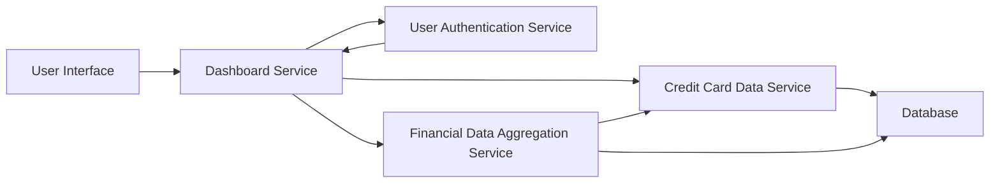

#### 1. High-Level Design

- **Summary:** This epic provides a consolidated dashboard interface for users to view and manage multiple credit cards. It displays key financial metrics including monthly spend, total credit limit, available credit, and outstanding amounts across all cards, enabling users to understand their credit utilization and financial position at a glance.

- **Component Flow:**

- **Integration Points:**
  - **Upstream:** Credit card data service (provides card details and balances), User authentication service (validates user identity and access rights), Financial data aggregation service (consolidates multi-card financial metrics)
  - **Internal:** Dashboard Service (orchestrates data retrieval and KPI calculations)
  - **Downstream:** User Interface (displays consolidated dashboard)

- **Key Assumptions:**
  - Credit card data is refreshed near real-time via scheduled polling or event-driven updates from the Credit Card Data Service; "near real-time" is assumed to be within 5-10 seconds of actual transaction posting.
  - Available credit is calculated as (Total Credit Limit - Outstanding Amount) without complex business rules for holds or pending transactions.

- **NFR Highlights:** Dashboard must load within 2 seconds; system must support responsive layouts across desktop and mobile devices; data refresh rate should be near real-time.

- **Data Flow:** User logs in → User Authentication Service validates credentials → Dashboard Service requests card data from Credit Card Data Service → Financial Data Aggregation Service consolidates metrics (monthly spend, credit limits, available credit, outstanding amounts) across all user cards → Aggregated KPIs are returned to Dashboard Service → User Interface renders consolidated dashboard with all cards and metrics within 2-second load time.

#### 2. Validation Report

- **Requirements Coverage:** The design comprehensively covers all stated requirements including dashboard KPIs display, multiple credit card view, monthly spend tracking, total credit limit aggregation, available credit calculation, and outstanding amount display. The architecture supports the NFR requirements for 2-second load time through efficient aggregation and the responsive layout requirement through separation of concerns between backend services and UI. The integration with User Authentication Service ensures secure access, and the Financial Data Aggregation Service provides the consolidation logic needed for multi-card management.