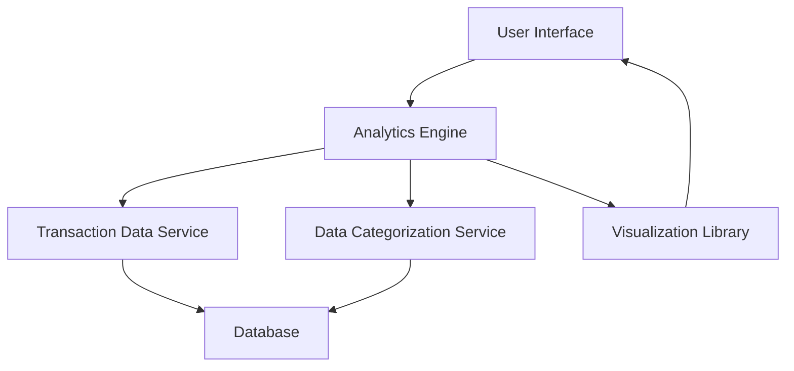

#### 1. High-Level Design

- **Summary:** This epic delivers comprehensive spending analytics and transaction insights through interactive visualizations. It enables users to analyze spending patterns across nine predefined categories (Food & Dining, Fuel, Shopping, Travel, Entertainment, Utilities, Healthcare, Education, Miscellaneous), view monthly spend trends, and perform card-wise spend analysis to optimize credit card usage.

- **Component Flow:**

- **Integration Points:**
  - **Upstream:** Transaction data service (provides raw transaction data)
  - **Internal:** Data categorization service (categorizes transactions into predefined categories), Analytics engine (processes and aggregates data)
  - **Downstream:** Visualization library (renders charts and graphs)

- **Key Assumptions:**
  - Transaction data is pre-enriched with merchant category codes or similar metadata to enable automatic categorization; categorization logic assumes standard merchant classification.
  - Analytics calculations (aggregations, trends) are performed on-demand or via scheduled batch processing with acceptable latency within the 1.5-second rendering requirement.

- **NFR Highlights:** Analytics visualizations must render within 1.5 seconds; system must handle up to 10,000 transactions per user; charts must be interactive with drill-down capabilities.

- **Data Flow:** User requests analytics view → Analytics engine fetches transaction data from Transaction Data Service → Data Categorization Service applies category rules to transactions → Aggregated data is processed for trends and card-wise analysis → Visualization Library renders interactive charts → User interface displays visualizations with drill-down capabilities.

#### 2. Validation Report

- **Requirements Coverage:** The design fully covers the epic's stated scope including category-wise spending visualization, monthly spend trend analysis, card-wise spend analysis, interactive charts, transaction categorization, and spending pattern identification. All nine spending categories are supported, and the architecture accommodates the NFR requirements for rendering performance (1.5 seconds) and transaction volume (10,000 per user). The modular design with separate Analytics Engine and Data Categorization Service ensures scalability and maintainability.