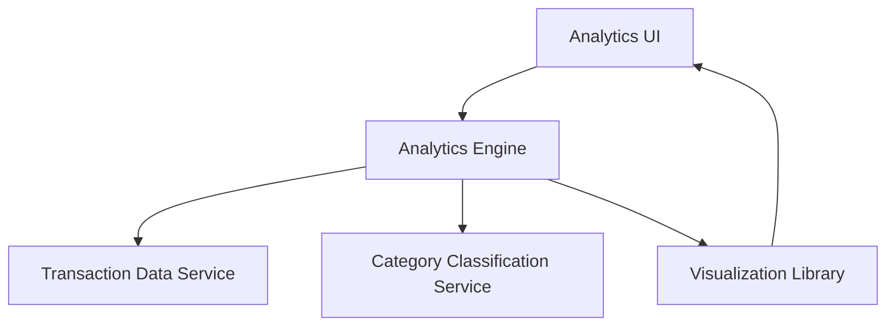

#### 1. High-Level Design

- **Summary:** This epic delivers interactive visualizations and analytics for users to understand spending patterns across 9 predefined categories (Food & Dining, Fuel, Shopping, Travel, Entertainment, Utilities, Healthcare, Education, Miscellaneous). It includes monthly spend trends, card-wise spend breakdown, and interactive charts to enable data-driven financial decisions.

- **Component Flow:**

- **Integration Points:**
  - **Upstream:** Transaction data service (for raw transaction data)
  - **Downstream:** Analytics engine (for data aggregation and trend calculation), Category classification service (for categorizing transactions), Visualization library (for rendering charts)

- **Key Assumptions:** 
  - Transactions are pre-classified into the 9 categories by the category classification service.
  - Monthly trend analysis covers up to 12 months of historical transaction data stored in the transaction data service.

- **NFR Highlights:** Visualizations must render within 3 seconds; support interactive filtering and drill-down; handle transaction data for up to 12 months; charts must be responsive across devices.

#### 2. Validation Report

- **Requirements Coverage:** The design fully addresses the epic's scope including category-wise spending visualization, monthly spend trend analysis, card-wise spend breakdown, interactive charts, and support for 9 spending categories. The architecture supports all NFRs with the analytics engine handling 12 months of data, the visualization library ensuring 3-second render times and responsive design, and interactive filtering capabilities built into the analytics UI layer.