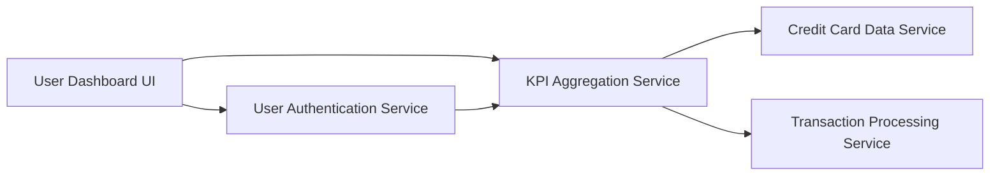

#### 1. High-Level Design

- **Summary:** This epic provides a consolidated dashboard displaying key performance indicators (KPIs) for the user's credit card portfolio, including Monthly Spend, Total Credit Limit, Available Credit, and Outstanding Amount. The dashboard offers real-time visibility into financial health and credit utilization across all cards through a responsive interface.

- **Component Flow:**

- **Integration Points:**
  - **Upstream:** User authentication service (for user session validation)
  - **Downstream:** Credit card data service (for card information and limits), Transaction processing service (for spending calculations and outstanding amounts)

- **Key Assumptions:** 
  - Monthly spend is calculated based on current calendar month transactions.
  - Real-time data refresh uses polling or event-driven updates from transaction processing service.

- **NFR Highlights:** Dashboard must load within 2 seconds; responsive design for mobile and desktop; real-time data refresh capability; support for concurrent users viewing dashboards.

#### 2. Validation Report

- **Requirements Coverage:** The design comprehensively addresses all KPI display requirements (Monthly Spend, Total Credit Limit, Available Credit, Outstanding Amount) and the consolidated view across all cards. The responsive dashboard layout is supported through the UI layer, and NFRs for 2-second load time and concurrent user support are met through the KPI aggregation service architecture that pre-computes and caches dashboard metrics.