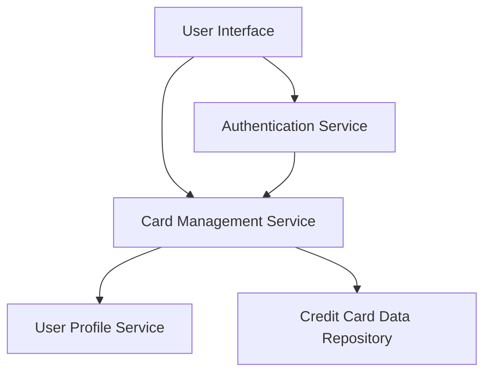

#### 1. High-Level Design

- **Summary:** This epic delivers a unified interface for users to manage and view multiple credit cards simultaneously. Users can access individual card details, limits, balances, and spending analysis from a single consolidated view, enabling easy comparison and tracking across their entire credit card portfolio.

- **Component Flow:**

- **Integration Points:**
  - **Upstream:** User profile service (for card associations), Authentication and authorization service
  - **Downstream:** Credit card data repository (for retrieving card metadata and balances)

- **Key Assumptions:** 
  - Card metadata is pre-populated in the repository and does not require real-time bank API calls.
  - Card identification uses a unique identifier (e.g., last 4 digits + card type) for display purposes.

- **NFR Highlights:** System must support minimum 10 credit cards per user; card data must be displayed within 1 second of selection; secure storage with data encryption for card information.

#### 2. Validation Report

- **Requirements Coverage:** The design fully covers the epic's stated scope including display of multiple credit cards, individual card details, card-wise spend analysis, credit limits, outstanding balances, and card identification. All NFRs related to performance (1-second load), capacity (10+ cards), and security (encryption) are addressed through the proposed architecture with dedicated services for authentication, profile management, and data retrieval.