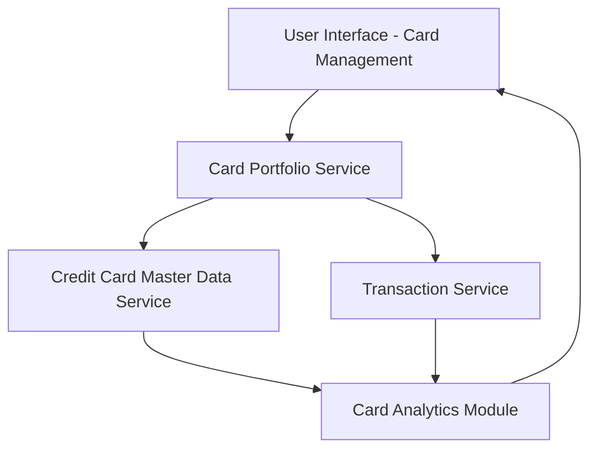

#### 1. High-Level Design

- **Summary:** This epic enables users to manage and monitor multiple credit cards from a unified interface, providing card-specific details, spend analysis, and performance tracking for individual cards. Users can view all cards, filter/select specific cards, and analyze card-wise spending patterns, outstanding balances, and credit limit utilization to optimize their credit card portfolio usage.

- **Component Flow:**

- **Integration Points:**
  - **Upstream:** Credit Card master data service (provides card details, limits, balances)
  - **Upstream:** Transaction service (provides card-wise spending data and transaction history)
  - **Internal:** Card Portfolio Service for aggregating multi-card data and filtering

- **Key Assumptions:**
  - Card data retrieval uses indexed queries to meet 500ms performance requirement; unlimited cards are supported through pagination or lazy loading.
  - Card selection and filtering are client-side operations for performance with 10+ cards displayed.

- **NFR Highlights:** System must support display of unlimited number of cards per user; Card data retrieval must complete within 500ms; Interface must maintain performance with 10+ cards displayed.

#### 2. Validation Report

- **Requirements Coverage:** The design fully addresses the epic's scope including multiple card display, card-wise spend analysis, individual card details, card selection/filtering, and card-specific balance tracking. The architecture supports the unlimited card requirement through the Card Portfolio Service's scalable design and the 500ms retrieval requirement through optimized data access patterns. The separation of the Card Analytics Module ensures that card-specific performance metrics and spending analysis can be computed efficiently even with 10+ cards. All dependencies on Credit Card master data and Transaction services are properly integrated into the component flow.