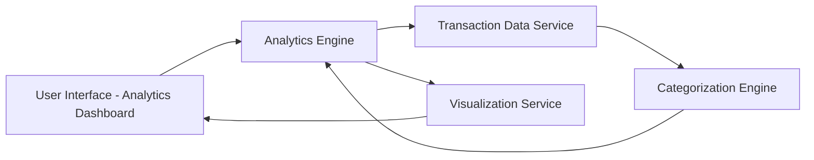

#### 1. High-Level Design

- **Summary:** This epic provides interactive analytics and visualization capabilities that enable users to understand spending behavior through category-wise analysis across nine predefined categories (Food & Dining, Fuel, Shopping, Travel, Entertainment, Utilities, Healthcare, Education, Miscellaneous) and monthly spend trend tracking. The feature supports historical analysis for at least 12 months to identify spending patterns and optimization opportunities.

- **Component Flow:**

- **Integration Points:**
  - **Upstream:** Transaction data service (provides categorized transaction records)
  - **External (Optional):** External categorization engine for transaction classification
  - **Internal:** Visualization Service for rendering interactive charts and graphs

- **Key Assumptions:**
  - Transactions are pre-categorized or categorization occurs at ingestion time; historical data for 12+ months is readily accessible.
  - Chart rendering uses standard JavaScript visualization libraries compatible with responsive design requirements.

- **NFR Highlights:** Visualizations must render within 2 seconds; Analytics must support historical data for at least 12 months; Charts must be interactive and responsive across all devices.

#### 2. Validation Report

- **Requirements Coverage:** The design comprehensively addresses the epic's scope including all nine spending categories, monthly trend analysis, interactive visualizations, and transaction categorization. The architecture supports the 2-second rendering requirement through dedicated visualization service and efficient data retrieval from the transaction service. Historical data support for 12 months is architecturally enabled through the Analytics Engine's data aggregation capabilities. The separation of categorization logic allows for both internal and external categorization engine integration as specified in dependencies.