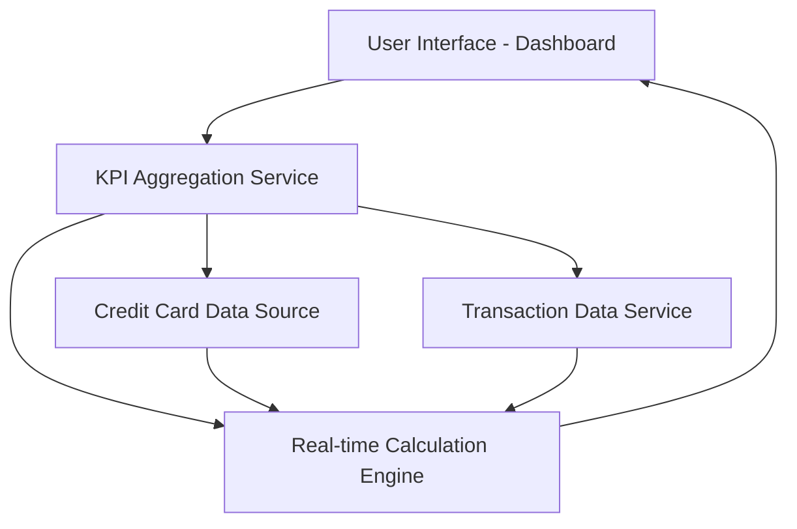

#### 1. High-Level Design

- **Summary:** This epic delivers a consolidated dashboard that aggregates and displays key financial metrics (Monthly Spend, Total Credit Limit, Available Credit, Outstanding Amount) across all user credit cards in real-time. The dashboard provides a unified view enabling users to quickly assess their overall credit card financial health and make informed spending decisions.

- **Component Flow:**

- **Integration Points:**
  - **Upstream:** Credit Card data source (provides card details, credit limits, outstanding balances)
  - **Upstream:** Transaction data service (provides transaction history for spending calculations)
  - **Internal:** KPI Aggregation Service for multi-card metric consolidation

- **Key Assumptions:**
  - Credit card data and transaction data are available via RESTful APIs with JSON format.
  - Real-time updates are achieved through polling or event-driven mechanisms with sub-second latency requirements.

- **NFR Highlights:** Dashboard must be responsive across mobile, tablet, and desktop devices; KPI calculations must update in real-time; System must support concurrent viewing by multiple users.

#### 2. Validation Report

- **Requirements Coverage:** The design fully covers the epic's stated scope including all four KPIs (Monthly Spend, Total Credit Limit, Available Credit, Outstanding Amount), responsive layout, and multi-card aggregation. The component flow addresses real-time calculation requirements and integration with necessary data sources. All NFRs related to responsiveness, real-time updates, and concurrent user support are architecturally addressed through the separation of concerns between UI, aggregation service, and calculation engine.