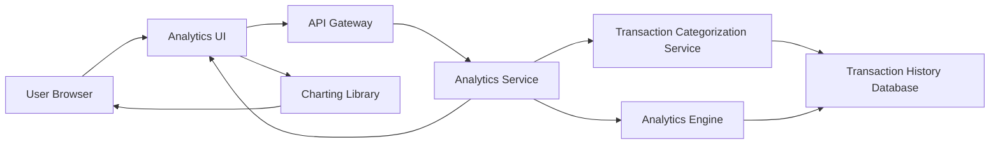

#### 1. High-Level Design

- **Summary**: This epic provides interactive visualizations and analytics to help users understand spending behavior across predefined categories (Food & Dining, Fuel, Shopping, Travel, Entertainment, Utilities, Healthcare, Education, Miscellaneous). It includes monthly spend trend analysis over up to 12 months, enabling users to identify patterns and make data-driven budget decisions through interactive charts and drill-down capabilities.

- **Component Flow**:

- **Integration Points**: 
  - **Upstream**: Transaction History Database (provides historical transaction data up to 12 months)
  - **Internal**: Transaction Categorization Service (classifies expenses into predefined categories), Analytics Engine (performs trend calculations and pattern identification), Charting Library (renders visualizations)
  - **Downstream**: Analytics UI displays interactive charts and spending insights to user

- **Key Assumptions**: 
  - Transactions are auto-categorized by the Transaction Categorization Service using predefined rules or ML models
  - Monthly trend analysis defaults to last 12 months unless user specifies a different time range

- **NFR Highlights**: Analytics visualizations must render within 3 seconds, support interactive filtering and drill-down capabilities, handle up to 12 months of transaction history for trend analysis, ensure accurate categorization of transactions

- **Data Flow**: User requests spending insights → Analytics Service retrieves transaction history from Transaction History Database → Transactions are processed through Transaction Categorization Service to assign categories → Analytics Engine aggregates spending by category and calculates monthly trends → Processed data is returned to Analytics UI → Charting Library renders interactive visualizations (category breakdown pie/bar charts, monthly trend line graphs) → User can filter by category, time period, or drill down into specific spending patterns

#### 2. Validation Report

- **Requirements Coverage**: The design fully addresses the epic scope including category-wise spending visualization for all 9 specified categories, monthly spend trends analysis, interactive charts and graphs, and spending pattern identification. NFRs are met through optimized rendering (3-second target), interactive charting library supporting filtering and drill-down, data architecture supporting 12-month history, and accurate categorization service. All integration dependencies (transaction categorization service, transaction history database, analytics engine, charting library) are explicitly mapped and integrated into the data flow.