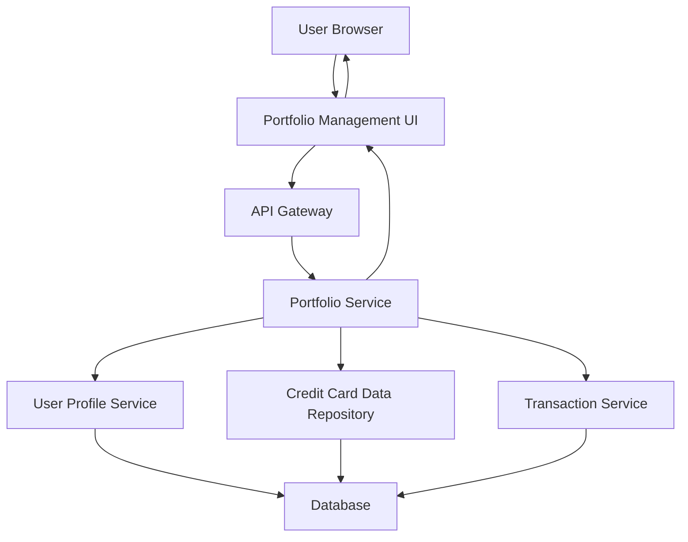

#### 1. High-Level Design

- **Summary**: This epic enables users to manage and view multiple credit cards (up to 10+) within a unified interface. It provides card listing, card-specific details, individual card spend analysis, and the ability to compare performance across the credit card portfolio. Users can filter, select, and view per-card metrics including credit limits, balances, and utilization.

- **Component Flow**:

- **Integration Points**: 
  - **Upstream**: User Profile Service (validates card ownership)
  - **Internal**: Credit Card Data Repository (stores and retrieves card information), Transaction Service (provides card-specific spending data)
  - **Downstream**: Portfolio Management UI displays card list and individual card analytics

- **Key Assumptions**: 
  - Card ownership is validated through User Profile Service before displaying cards
  - Card-wise spend analysis covers current month unless historical period is specified by user

- **NFR Highlights**: System must support display of at least 10 credit cards per user, card data retrieval must complete within 1 second, ensure secure handling of sensitive card information

- **Data Flow**: User accesses portfolio view → Portfolio Service validates user identity via User Profile Service → Service retrieves all user-owned cards from Credit Card Data Repository → For each card, spending data is fetched from Transaction Service → Aggregated card list with individual metrics (limit, balance, utilization, spend) is returned to UI → User can filter/select specific cards for detailed analysis → Selected card details and spend breakdown are displayed

#### 2. Validation Report

- **Requirements Coverage**: The design comprehensively addresses the epic scope including multiple credit card display, card-wise spend analysis, individual card details view, card listing interface, card selection and filtering, and per-card credit limit and balance display. NFRs are satisfied through architecture supporting 10+ cards, sub-1-second retrieval time via optimized data access, and secure handling through authentication and authorization layers. All integration dependencies (credit card data repository, user profile service, transaction service) are incorporated into the component flow.