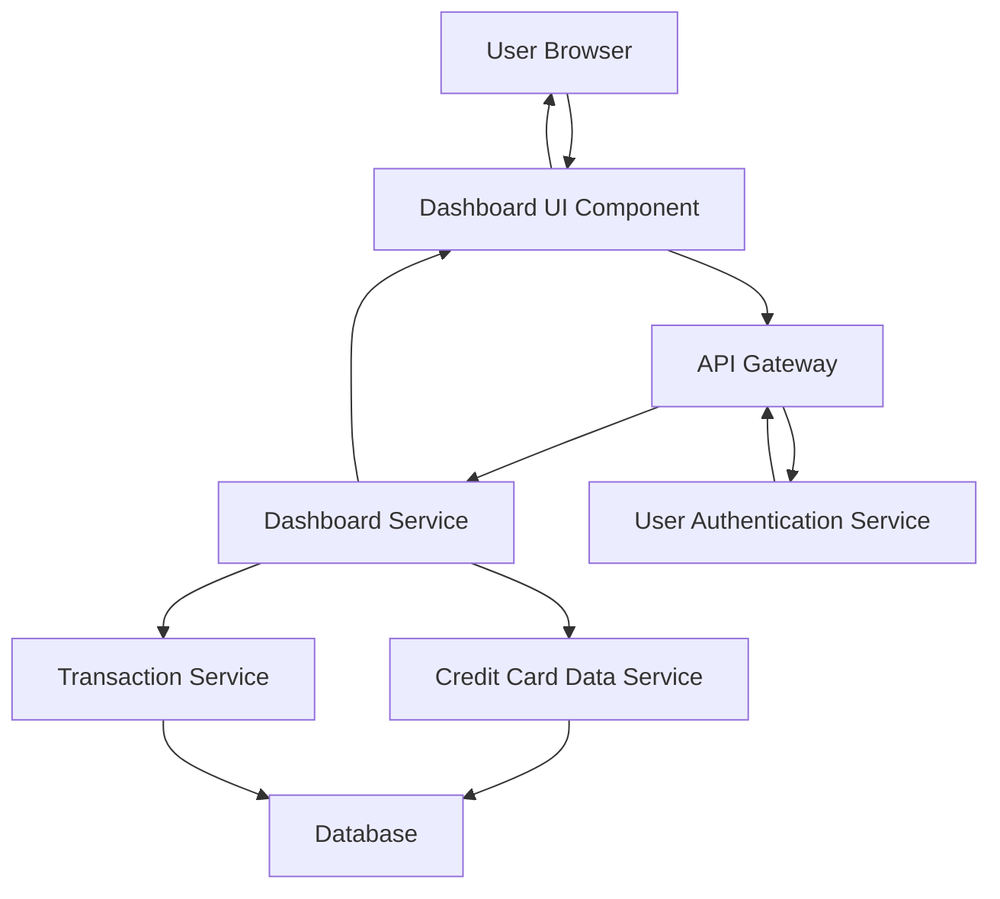

#### 1. High-Level Design

- **Summary**: This epic delivers a responsive dashboard that consolidates key credit card portfolio metrics including monthly spending, total credit limit, available credit, and outstanding amounts. The dashboard provides real-time visibility into financial health and credit utilization across all user credit cards through an intuitive KPI visualization interface.

- **Component Flow**:

- **Integration Points**: 
  - **Upstream**: User Authentication Service (for secure access validation)
  - **Internal**: Credit Card Data Service (fetches card details and balances), Transaction Service (calculates monthly spend)
  - **Downstream**: Dashboard UI renders aggregated data to user browser

- **Key Assumptions**: 
  - Monthly spend is calculated based on transaction data from the current calendar month
  - Real-time data refresh implies periodic polling or push notifications from backend services (frequency not specified)

- **NFR Highlights**: Dashboard must load within 2 seconds, support responsive design for mobile and desktop, handle real-time data refresh, ensure data accuracy for financial calculations

- **Data Flow**: User authenticates → Dashboard Service requests card details from Credit Card Data Service and monthly transactions from Transaction Service → Services query Database → Aggregated KPIs (total credit limit, available credit, outstanding amount, monthly spend) are calculated → Data returned to Dashboard UI → KPIs rendered as visual components in responsive layout

#### 2. Validation Report

- **Requirements Coverage**: The design fully covers the epic's stated scope including monthly spend display, credit limit aggregation, available credit calculation, outstanding amount tracking, responsive dashboard layout, and KPI visualization. All NFRs (2-second load time, responsive design, real-time refresh, data accuracy) are addressed through appropriate service architecture and UI component design. Integration dependencies with credit card data service, transaction service, and authentication service are explicitly mapped in the component flow.