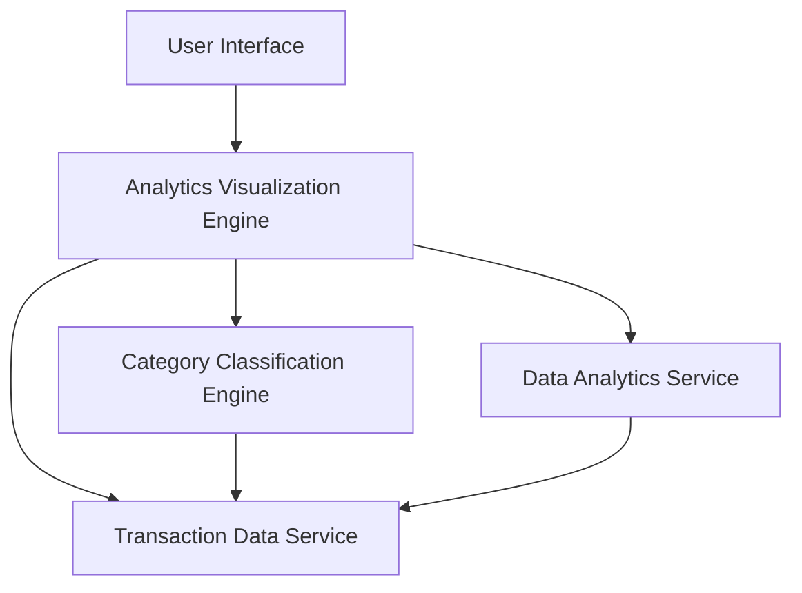

### 1. High-Level Design

**Summary:**  
This epic delivers interactive analytics and visualization capabilities enabling users to understand spending patterns through category-wise analysis and monthly spend trends across nine predefined categories (Food & Dining, Fuel, Shopping, Travel, Entertainment, Utilities, Healthcare, Education, Miscellaneous).

**Component Flow:**

**Integration Points:**
- **Upstream:** Transaction Data Service (spending records retrieval)
- **Downstream:** Category Classification Engine (transaction categorization), Data Analytics Service (trend calculation and pattern analysis)

**Key Assumptions:**
- Transaction categorization is automated using the Category Classification Engine with manual override capability.
- Historical data for 12 months is pre-aggregated and cached for performance optimization.

**NFR Highlights:**  
Analytics visualizations must render within 3 seconds, support historical data analysis for at least 12 months, provide interactive and responsive charts across all device types, and maintain 99.9% data aggregation accuracy.

### 2. Validation Report

**Requirements Coverage:**  
The design fully addresses all scope requirements including category-wise spending visualization, monthly spend trend analysis, interactive charts and graphs, nine spending category tracking, spending pattern identification, and time-based spending comparison. All NFRs (3-second render time, 12-month historical data, responsive interactivity, 99.9% accuracy) are supported through the specialized analytics visualization engine integrated with transaction data service, category classification engine, and data analytics service for comprehensive spending insights.