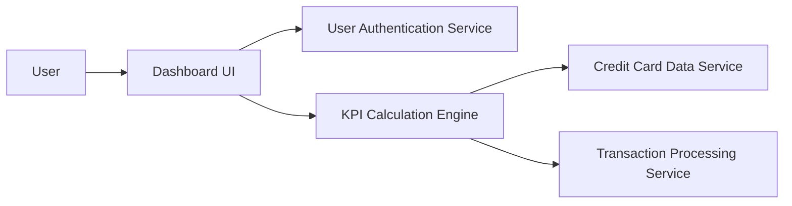

### 1. High-Level Design

**Summary:**  
This epic delivers a comprehensive dashboard interface providing users with a consolidated view of all credit cards and key financial metrics (monthly spend, total credit limit, available credit, outstanding amounts). The dashboard serves as the central hub for credit card management and financial oversight.

**Component Flow:**

**Integration Points:**
- **Upstream:** User Authentication Service (secure access control)
- **Downstream:** Credit Card Data Service (card information retrieval), Transaction Processing Service (monthly spend and outstanding amount calculations)

**Key Assumptions:**
- KPI calculations are performed server-side with caching to meet 2-second load time requirement.
- Dashboard refresh frequency is configurable, defaulting to real-time or near real-time updates.

**NFR Highlights:**  
Dashboard must load within 2 seconds, support responsive design across desktop/tablet/mobile devices, comply with WCAG 2.1 accessibility standards, and refresh data in real-time or near real-time.

### 2. Validation Report

**Requirements Coverage:**  
The design comprehensively covers all scope elements including dashboard interface design, monthly spend KPI display, total credit limit aggregation, available credit calculation, outstanding amount tracking, multiple credit card view integration, and responsive layout implementation. All NFRs (2-second load time, responsive design, WCAG 2.1 compliance, real-time refresh) are addressed through the layered architecture with dedicated KPI calculation engine and integration with authentication and data services.