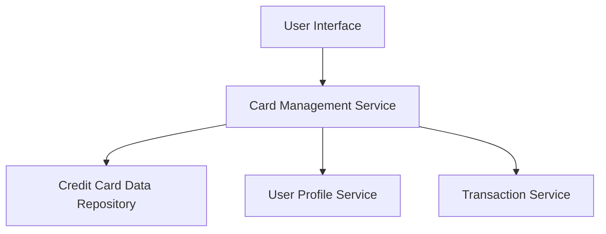

### 1. High-Level Design

**Summary:**  
This epic enables users to view and manage multiple credit cards within the dashboard, providing card-wise spend analysis, individual card details, and credit utilization tracking. Users can monitor each card's performance separately while maintaining an aggregated view across all cards.

**Component Flow:**

**Integration Points:**
- **Upstream:** User Profile Service (for card ownership validation)
- **Downstream:** Credit Card Data Repository (card information retrieval), Transaction Service (card-specific spending data)

**Key Assumptions:**
- Card data is stored in a centralized repository with standardized schema for all card types.
- Real-time synchronization is not required; near real-time updates (within 1 second) are acceptable.

**NFR Highlights:**  
System must support display of at least 10 credit cards per user with card data retrieval completing within 1 second; data accuracy must be 100% for card balances and limits.

### 2. Validation Report

**Requirements Coverage:**  
The design covers all stated scope items including multiple credit card display interface, card-wise spend analysis, individual card detail views, card listing and organization, credit utilization tracking per card, and card selection/filtering capabilities. All NFRs (10+ cards support, 1-second retrieval, concurrent sessions, 100% accuracy) are addressed through the component architecture and integration with necessary services.