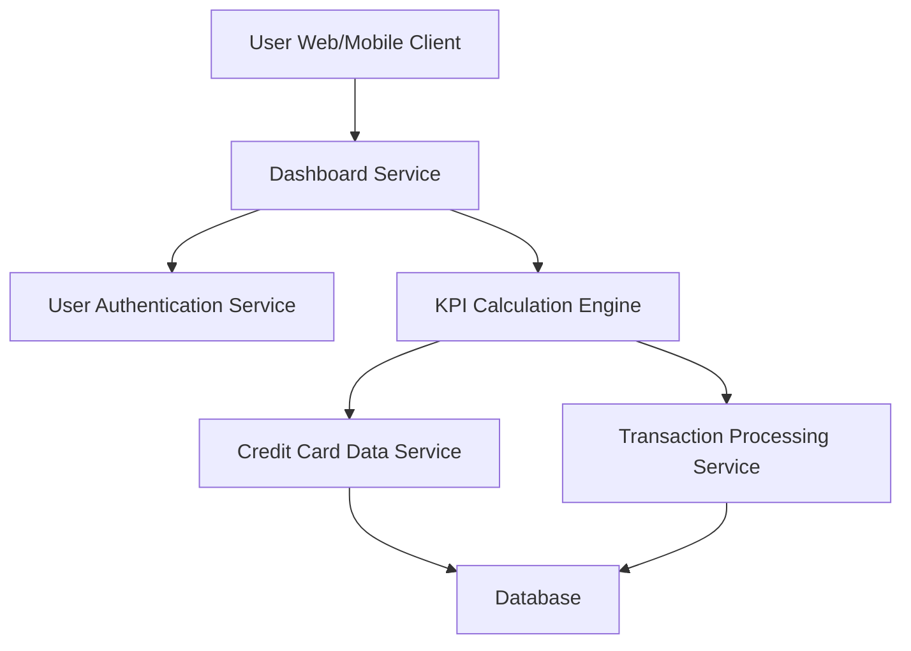

#### 1. High-Level Design

- **Summary:** This epic provides a consolidated dashboard displaying key performance indicators (KPIs) for the user's credit card portfolio. The dashboard shows real-time financial metrics including monthly spend, total credit limit, available credit, and outstanding amounts across all cards in a responsive interface, enabling informed financial decision-making.

- **Component Flow:**

- **Integration Points:**
  - **Upstream:** User Authentication Service (secure access control)
  - **Downstream:** Credit Card Data Service (card information and balances), Transaction Processing Service (monthly spend calculation)

- **Key Assumptions:**
  - KPI calculations are performed server-side with caching to meet 2-second load time requirement.
  - "Real-time" data refresh means data is current within 5 minutes; actual real-time streaming is not required.

- **NFR Highlights:** Dashboard must load within 2 seconds; responsive design across desktop, tablet, and mobile devices; real-time data refresh for KPI metrics; support for concurrent users viewing dashboards.

- **Data Flow:** User authenticates and accesses dashboard → Dashboard Service validates session with User Authentication Service → KPI Calculation Engine fetches card data from Credit Card Data Service and transaction data from Transaction Processing Service → Engine calculates aggregated KPIs (total credit limit, available credit, outstanding amount, monthly spend) → Calculated metrics are cached and returned to Dashboard Service → Dashboard Service formats data for responsive UI → User views consolidated KPI dashboard with real-time metrics → Dashboard auto-refreshes at defined intervals to maintain data currency.

#### 2. Validation Report

- **Requirements Coverage:** The design fully addresses the epic scope including dashboard KPI display, monthly spend tracking, total credit limit aggregation, available credit calculation, outstanding amount monitoring, responsive layout implementation, and multi-card consolidated view. All NFRs are satisfied: 2-second load time through caching strategy, responsive design through adaptive UI components, real-time refresh through polling mechanism, and concurrent user support through scalable service architecture.