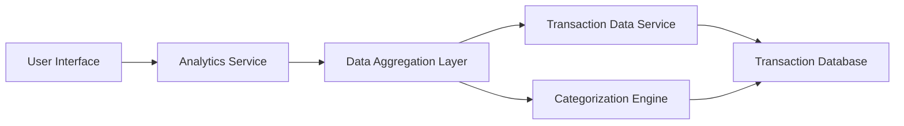

#### 1. High-Level Design

- **Summary:** This epic delivers comprehensive spending analytics through interactive visualizations and trend analysis. Users can explore spending patterns across 9 predefined categories (Food & Dining, Fuel, Shopping, Travel, Entertainment, Utilities, Healthcare, Education, Miscellaneous) with monthly trend analysis to support data-driven financial decisions.

- **Component Flow:**

- **Integration Points:**
  - **Upstream:** Transaction Data Service (raw transaction details), Categorization Engine (transaction classification logic)
  - **Downstream:** Analytics Service (data aggregation and trend calculation), Data Aggregation Layer (historical data processing)

- **Key Assumptions:**
  - Transactions are pre-categorized by the Categorization Engine; manual re-categorization is out of scope.
  - Historical data is stored for 12 months minimum; older data may be archived but not displayed in analytics.

- **NFR Highlights:** Analytics visualizations must render within 3 seconds; support for minimum 12 months of historical data; responsive charts across all devices; 99.9% data aggregation accuracy.

- **Data Flow:** User accesses analytics dashboard → Analytics Service requests aggregated spending data from Data Aggregation Layer → Layer fetches raw transactions from Transaction Data Service and category mappings from Categorization Engine → Data is aggregated by category and time period → Results are formatted for visualization → UI renders interactive charts showing category-wise breakdown and monthly trends → User interacts with charts to drill down into specific categories or time periods.

#### 2. Validation Report

- **Requirements Coverage:** The design comprehensively addresses all scope elements including category-wise visualization (9 categories), monthly spend trends, interactive analytics charts, spending pattern analysis, transaction categorization, multi-category breakdown, and historical trend comparison. All NFRs are covered: 3-second render time through optimized aggregation layer, 12-month historical data support, responsive design, and 99.9% accuracy through validated categorization engine.