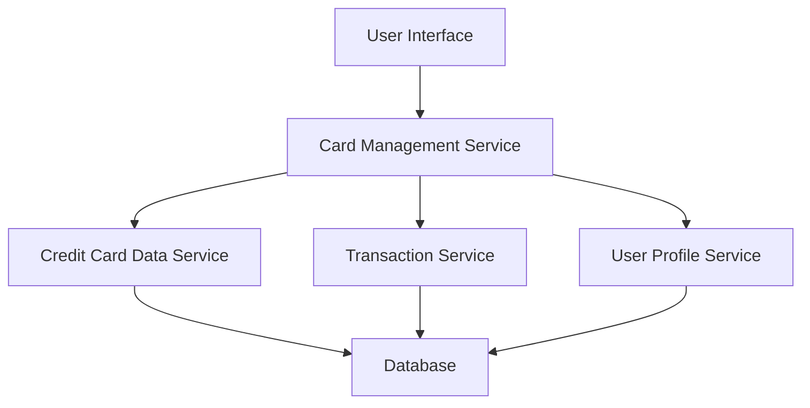

#### 1. High-Level Design

- **Summary:** This epic enables users to manage and view multiple credit cards within a single unified interface. The system provides detailed card-specific information including limits, balances, and transaction details, with seamless navigation between cards and comparative spend analysis across the portfolio.

- **Component Flow:**

- **Integration Points:**
  - **Upstream:** User Profile Service (for card-user associations and authentication)
  - **Downstream:** Credit Card Data Service (card metadata and details), Transaction Service (card-specific spending data)

- **Key Assumptions:**
  - Card data is retrieved via REST APIs with JSON format.
  - Card metadata is refreshed on-demand when user navigates to card details; real-time sync is not required for static card information.

- **NFR Highlights:** System must support minimum 10 credit cards per user with card switching response time under 500ms; secure storage of card metadata required.

- **Data Flow:** User requests card portfolio view → Card Management Service retrieves user's card associations from User Profile Service → For each card, service fetches card details from Credit Card Data Service and spending data from Transaction Service → Aggregated data is presented in UI with navigation controls → User selects specific card → Detailed card view loads with card-specific balance, limit, and transaction history.

#### 2. Validation Report

- **Requirements Coverage:** The design fully covers the epic's stated scope including multiple card display, card-wise spend analysis, individual card detail views, navigation, balance tracking, and comparison capabilities. All NFRs (10 cards per user, <500ms switching, data consistency, secure storage) are addressed through the component architecture and service integration patterns.