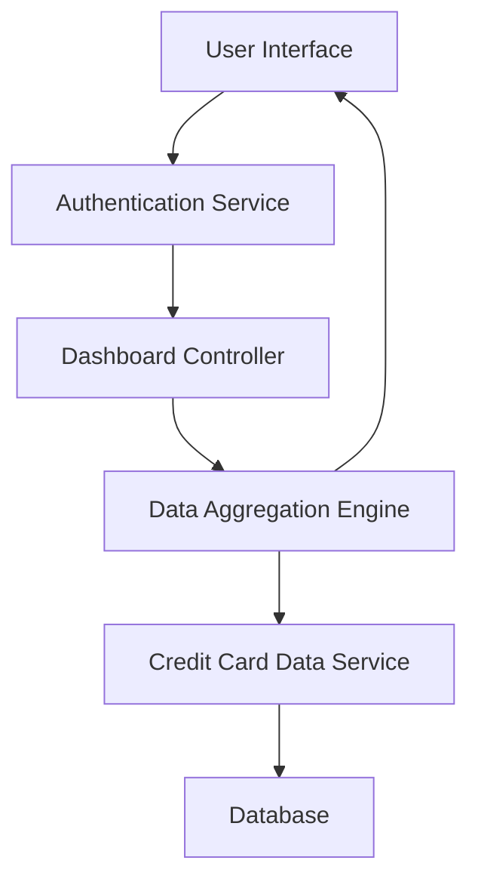

#### 1. High-Level Design

- **Summary:** This epic delivers a consolidated credit card portfolio dashboard that displays key performance indicators including monthly spend, total credit limit, available credit, and outstanding amounts across multiple credit cards. The solution provides users with real-time financial visibility and credit utilization tracking through a responsive interface accessible on mobile and desktop devices.

- **Component Flow:**

- **Integration Points:**
  - **Upstream:** User Authentication Service (for secure access and user identity verification)
  - **Downstream:** Credit Card Data Service (for fetching card details, balances, limits, and outstanding amounts)

- **Key Assumptions:**
  - Credit card data is available via RESTful API with JSON format from the Credit Card Data Service.
  - Data refresh occurs at regular intervals (assumed every 5 minutes) or on-demand user action.

- **NFR Highlights:** Dashboard must load within 2 seconds, support real-time data refresh, maintain responsive layout across devices (mobile, tablet, desktop), and handle up to 50 credit cards per user account.

#### 2. Validation Report

- **Requirements Coverage:** The design fully covers the epic's stated scope by addressing all KPI displays (monthly spend, credit limit, available credit, outstanding amount), multi-card view interface, consolidated dashboard layout, and responsive design requirements. The architecture supports the specified NFRs including 2-second load time through efficient data aggregation, real-time refresh capability, and scalability to handle 50 cards per user.