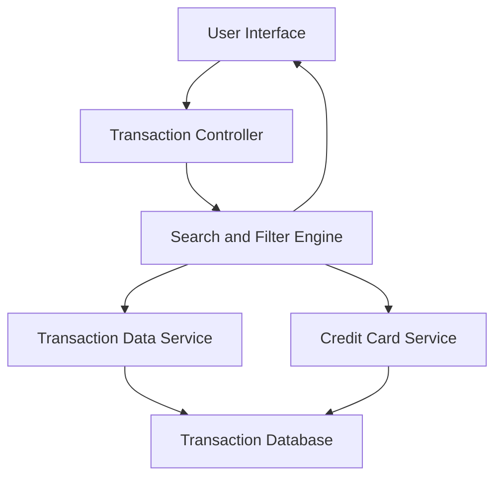

#### 1. High-Level Design

- **Summary:** This epic provides a centralized transaction management interface enabling users to view, search, and filter credit card transactions across their entire portfolio. The solution delivers complete visibility into spending activity with detailed transaction history, supporting efficient transaction lookup and spending pattern identification through a responsive, paginated interface.

- **Component Flow:**

- **Integration Points:**
  - **Upstream:** Credit Card Service (for card-specific transaction filtering and card metadata)
  - **Downstream:** Transaction Data Service (for retrieving transaction records and details)
  - **Supporting:** Date/Time Service (for transaction timestamp normalization and filtering)

- **Key Assumptions:**
  - Transaction data is retrieved via API with standardized transaction schema including amount, date, merchant, and card identifier.
  - Pagination is implemented server-side with default page size of 50 transactions.

- **NFR Highlights:** Transaction list must support pagination for large datasets, search and filter operations must complete within 1 second, system must handle minimum 10,000 transactions per user, and maintain data accuracy and consistency.

#### 2. Validation Report

- **Requirements Coverage:** The design comprehensively addresses the epic's scope including transaction list view, transaction details display, multi-card aggregation, search functionality, and filtering options. The architecture supports all specified NFRs through server-side pagination for scalability, optimized search indexing for sub-second response times, and data consistency mechanisms to handle 10,000+ transactions per user reliably.