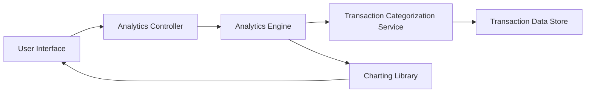

#### 1. High-Level Design

- **Summary:** This epic delivers an interactive analytics platform that visualizes spending patterns through category-wise breakdowns and monthly trend analysis. Users can analyze spending across 9 predefined categories (Food & Dining, Fuel, Shopping, Travel, Entertainment, Utilities, Healthcare, Education, Miscellaneous) and compare spending across different credit cards with historical data spanning at least 12 months.

- **Component Flow:**

- **Integration Points:**
  - **Upstream:** Transaction Categorization Service (for mapping transactions to spending categories)
  - **Downstream:** Analytics Engine (for aggregating and processing spending data across dimensions)
  - **Supporting:** Charting Library (for visualization rendering - likely D3.js, Chart.js, or similar)

- **Key Assumptions:**
  - Transaction categorization is performed automatically by the categorization service using merchant codes or machine learning.
  - Historical data aggregation is pre-computed and cached for performance optimization.

- **NFR Highlights:** Analytics visualizations must render within 3 seconds, support interactive filtering without page reload, handle historical data for minimum 12 months, and charts must be responsive and accessible across all device types.

#### 2. Validation Report

- **Requirements Coverage:** The design fully addresses the epic's requirements including category-wise spending visualization, monthly spend trend charts, card-wise spend analysis, interactive analytics dashboard, spending pattern identification, multi-dimensional data filtering, and responsive chart rendering. The architecture supports all NFRs through optimized data aggregation for 3-second render time, AJAX-based interactive filtering, 12+ months historical data retention, and responsive charting library implementation for cross-device accessibility.