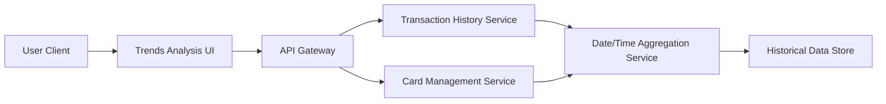

#### 1. High-Level Design

- **Summary:** This epic enables users to track and analyze spending trends over time on a monthly basis and view detailed card-wise spending analysis. Users can monitor month-over-month spending evolution and compare spending across different credit cards (up to 10 cards simultaneously), providing insights into usage patterns and helping optimize card utilization strategies.

- **Component Flow:**

- **Integration Points:**
  - **Upstream:** Transaction History Service (for retrieving historical spending data for at least 12 months)
  - **Upstream:** Card Management Service (for card-specific transaction filtering and multi-card comparison)
  - **Upstream:** Date/Time Service (for monthly aggregation, trend calculation, and time-based comparisons)
  - **Downstream:** Trends Analysis UI renders monthly trends and card-wise breakdowns to the user

- **Key Assumptions:**
  - Historical transaction data is retained for a minimum of 12 months and is readily accessible for trend analysis.
  - Monthly aggregation calculations are performed server-side by the Date/Time Aggregation Service; data format follows standard monthly periods (calendar months).

- **NFR Highlights:** Efficient retrieval and display of 12 months of historical data; accurate real-time trend calculations; support for simultaneous comparison of up to 10 cards.

#### 2. Validation Report

- **Requirements Coverage:** The HLD fully satisfies the epic's scope by defining the Trends Analysis UI that visualizes monthly spend trends and card-wise spending analysis. Integration with the Transaction History Service ensures access to 12 months of historical data, while the Card Management Service enables multi-card filtering and comparison (up to 10 cards). The Date/Time Aggregation Service supports month-over-month trend calculations. The architecture addresses all NFRs including efficient data retrieval, real-time updates, and multi-card comparison capabilities, ensuring comprehensive coverage of the stated requirements.