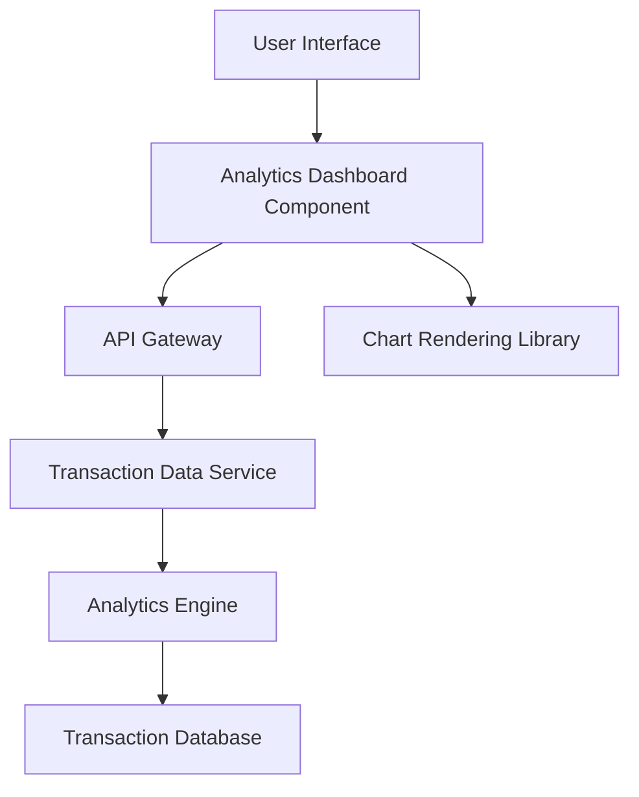

#### 1. High-Level Design

- **Summary:** This epic provides users with interactive visualizations and analytics to understand spending patterns across nine distinct categories: Food & Dining, Fuel, Shopping, Travel, Entertainment, Utilities, Healthcare, Education, and Miscellaneous. The solution enables users to identify spending trends and make informed financial decisions through visual insights and interactive charts.

- **Component Flow:**

- **Integration Points:**
  - **Upstream:** Transaction Data Service (for retrieving categorized transaction data across all spending categories)
  - **Upstream:** Analytics Engine (for processing, aggregating, and calculating category-wise spending metrics)
  - **Downstream:** Chart Rendering Library (for generating interactive visualizations on the client side)

- **Key Assumptions:**
  - Transactions are pre-categorized by the Transaction Data Service or a separate categorization engine; manual re-categorization is out of scope.
  - The Analytics Engine aggregates data on-demand or uses pre-computed aggregates refreshed periodically (e.g., hourly or daily).

- **NFR Highlights:** Analytics visualizations must render within 2 seconds; efficient handling of large transaction datasets; interactive and responsive charts across all device types.

#### 2. Validation Report

- **Requirements Coverage:** The HLD comprehensively covers the epic's requirements by defining the Analytics Dashboard Component that visualizes category-wise spending across all nine specified categories. Integration with the Transaction Data Service and Analytics Engine ensures accurate data retrieval and processing. The inclusion of a Chart Rendering Library addresses the interactive visualization requirement, and the architecture supports responsive design and performance constraints (2-second render time) through efficient data aggregation and client-side rendering strategies.