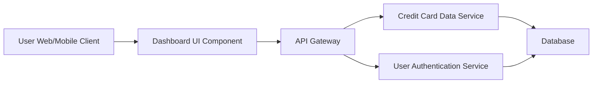

#### 1. High-Level Design

- **Summary:** This epic delivers a consolidated dashboard that displays key performance indicators (KPIs) for a user's credit card portfolio, including monthly spend, total credit limit, available credit, and outstanding amount. The solution enables users to monitor multiple credit cards from a single, responsive interface, providing a comprehensive financial snapshot for improved credit utilization visibility and financial health management.

- **Component Flow:**

- **Integration Points:**
  - **Upstream:** User Authentication Service (for secure user identity verification and session management)
  - **Upstream:** Credit Card Data Service (for fetching card details, balances, credit limits, and outstanding amounts)
  - **Downstream:** Dashboard UI renders data to user across responsive web/mobile interfaces

- **Key Assumptions:**
  - Credit card data is refreshed in near real-time or at defined intervals (e.g., every 5-15 minutes) from the Credit Card Data Service.
  - User authentication tokens are valid and managed by the Authentication Service; session timeout and renewal are handled externally.

- **NFR Highlights:** Responsive design across desktop, tablet, and mobile; optimized dashboard load time for quick KPI rendering; real-time data refresh support for balances and limits.

#### 2. Validation Report

- **Requirements Coverage:** The HLD fully addresses the epic's scope by defining the dashboard UI component that displays all four KPIs (Monthly Spend, Total Credit Limit, Available Credit, Outstanding Amount), integrates with the Credit Card Data Service and User Authentication Service as specified, and supports responsive design across multiple device types. The architecture supports multiple credit card views through the data service layer, ensuring consolidated interface requirements are met.