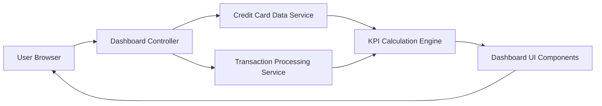

#### 1. High-Level Design

- **Summary**: This epic delivers a comprehensive dashboard serving as the primary landing page for credit card management. The dashboard displays key performance indicators including monthly spend, total credit limit, available credit, and outstanding amounts in a consolidated real-time view, enabling users to quickly assess their overall credit card portfolio health and financial position.

- **Component Flow**:

- **Integration Points**: 
  - **Upstream**: Credit card data service (for retrieving card balances, limits, and outstanding amounts)
  - **Upstream**: Transaction processing service (for calculating monthly spend and real-time transaction data)
  - **Internal**: KPI calculation engine (for aggregating metrics across all cards)
  - **Frontend**: Dashboard UI components (for responsive visualization of KPIs)

- **Key Assumptions**: 
  - Real-time data refresh is achieved through periodic polling or WebSocket connections with configurable refresh intervals.
  - Credit utilization is calculated as (Total Outstanding / Total Credit Limit) × 100; available credit is Total Credit Limit minus Total Outstanding.

- **NFR Highlights**: Dashboard must load within 2 seconds; support responsive design for mobile and desktop devices; handle real-time data refresh; ensure data accuracy for financial calculations.

- **Data Flow**: User accesses dashboard → Dashboard Controller requests data from Credit Card Data Service (card balances, limits, outstanding amounts) and Transaction Processing Service (monthly spend, recent transactions) → KPI Calculation Engine aggregates data across all cards to compute total credit limit, available credit, total outstanding, and monthly spend → Dashboard UI Components render KPIs in responsive layout optimized for user's device → Dashboard auto-refreshes to display real-time updates → User views consolidated financial health metrics at a glance.

#### 2. Validation Report

- **Requirements Coverage**: The design fully addresses the epic's scope including monthly spend display, total credit limit aggregation, available credit calculation, outstanding amount tracking, responsive dashboard layout, and KPI visualization components. The architecture satisfies all NFR requirements: 2-second load time, responsive design for mobile and desktop, real-time data refresh capability, and data accuracy for financial calculations. All dependencies (credit card data service, transaction processing service) are integrated into the component flow. Out-of-scope items (real bank integration, payment processing, fund transfers, payment gateway integration) are appropriately excluded as specified in the epic.