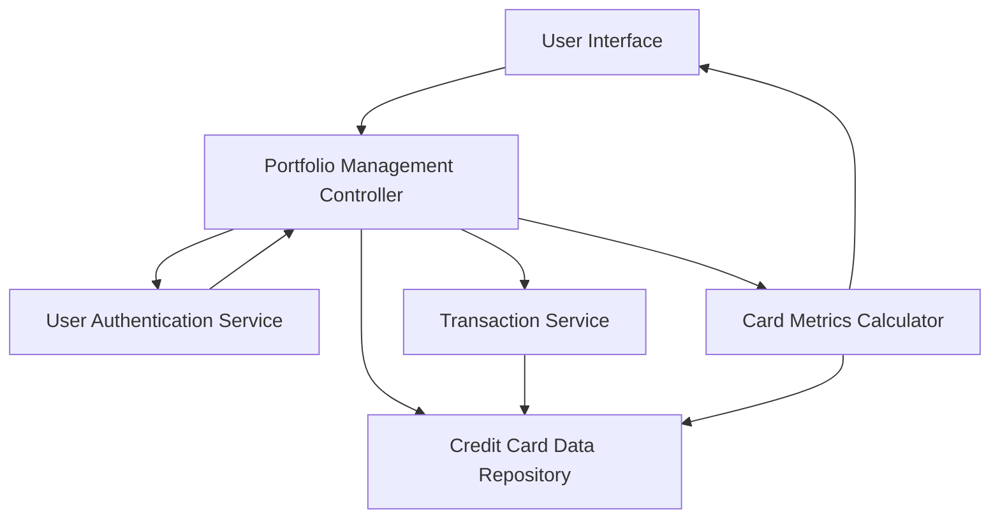

#### 1. High-Level Design

- **Summary**: This epic enables users to manage multiple credit cards from a unified interface. Users can view all their credit cards with individual details, perform card-wise spend analysis, track card-specific metrics, and add new cards. The system provides a consolidated view eliminating the need for multiple banking portals, supporting users with diverse credit portfolios.

- **Component Flow**:

- **Integration Points**: 
  - **Upstream**: User authentication service (for secure access and user identity verification)
  - **Internal**: Credit card data repository (for storing and retrieving card information)
  - **Internal**: Transaction service (for card-wise transaction history and spend calculations)
  - **Security**: Card masking service (for displaying masked card numbers)

- **Key Assumptions**: 
  - Card information is stored with encryption at rest; card numbers are masked showing only last 4 digits in the UI.
  - Card addition interface accepts manual entry; validation is performed against card number format and issuer identification.

- **NFR Highlights**: System must support minimum 10 credit cards per user; card data retrieval must complete within 3 seconds; secure storage and display of card information with masked card numbers is mandatory.

- **Data Flow**: User authenticates via User Authentication Service → Portfolio Management Controller retrieves user's credit cards from Credit Card Data Repository → For each card, Transaction Service fetches card-wise transaction history → Card Metrics Calculator computes card-specific metrics (spend, utilization, outstanding balance) → User Interface displays consolidated multi-card view with individual card details and masked card numbers → User can drill down into individual card details or add new cards through the card addition interface.

#### 2. Validation Report

- **Requirements Coverage**: The design comprehensively addresses the epic's scope including multiple credit card display, card-wise spend analysis, individual card detail views, card addition interface, and card-specific metrics tracking. The architecture meets NFR requirements for supporting minimum 10 cards per user, 3-second data retrieval, and secure storage with masked card numbers. All dependencies (user authentication service, credit card data repository, transaction service) are integrated into the design. Out-of-scope items (real bank integration, card payments, new card applications, credit limit requests, loans) are explicitly excluded as specified.