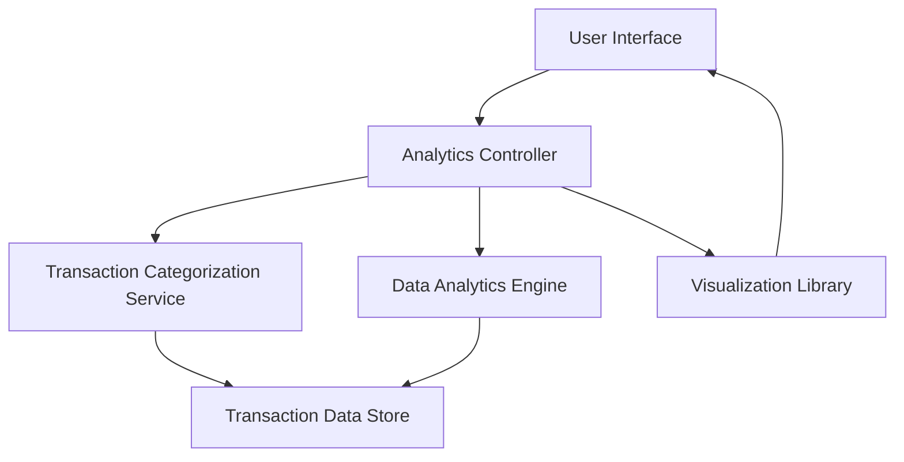

#### 1. High-Level Design

- **Summary**: This epic delivers an interactive analytics module that provides users with comprehensive spending insights across predefined categories (Food & Dining, Fuel, Shopping, Travel, Entertainment, Utilities, Healthcare, Education, Miscellaneous). The system will process transaction data, categorize spending, calculate trends over time, and present insights through interactive visualizations enabling data-driven financial decisions.

- **Component Flow**:

- **Integration Points**: 
  - **Upstream**: Transaction categorization service (for automatic category assignment)
  - **Internal**: Data analytics engine (for trend calculation and pattern analysis)
  - **Frontend**: Visualization library (for rendering interactive charts and graphs)
  - **Data Source**: Transaction data store (for historical transaction data up to 12 months)

- **Key Assumptions**: 
  - Transactions are pre-categorized or the categorization service uses rule-based or ML-based classification with predefined category mappings.
  - Monthly spend trends are calculated on-demand with caching for performance optimization.

- **NFR Highlights**: Analytics processing must complete within 5 seconds for up to 12 months of transaction data; visualizations must be interactive and responsive with drill-down capabilities.

- **Data Flow**: User requests spending insights → Analytics Controller fetches transaction data → Transaction Categorization Service assigns categories to uncategorized transactions → Data Analytics Engine aggregates spending by category and calculates monthly trends → Visualization Library renders interactive charts → User views category breakdown, trends, and can drill down into specific categories for detailed analysis.

#### 2. Validation Report

- **Requirements Coverage**: The design fully covers the epic's stated scope including category-wise spending visualization, monthly spend trends, interactive charts, and spending pattern analysis across all nine predefined categories. The architecture supports the NFR requirements for 5-second processing time and interactive visualizations. All identified dependencies (transaction categorization service, data analytics engine, visualization library) are incorporated into the component flow. The design excludes out-of-scope items (predictive forecasts, budget alerts, real bank integration, third-party integrations) as specified.