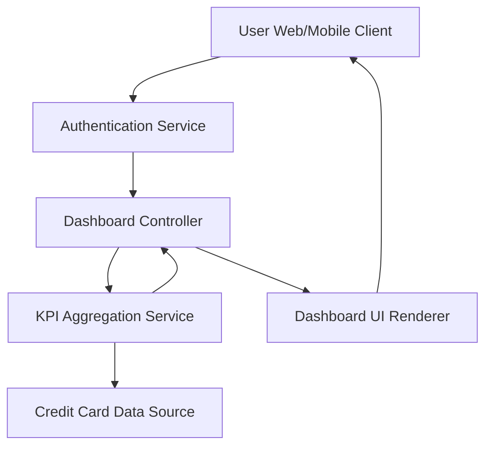

#### 1. High-Level Design

- **Summary:** This epic delivers a consolidated dashboard that displays key performance indicators (KPIs) for the user's credit card portfolio, including monthly spend, total credit limit, available credit, and outstanding amounts. The dashboard provides real-time visibility into overall credit card financial health with responsive design for multi-device access.

- **Component Flow:**

- **Integration Points:**
  - **Upstream:** Credit card data source (for card balances, limits, transaction data)
  - **Upstream:** User authentication service (for secure access and user identity)
  - **Internal:** KPI calculation and aggregation engine

- **Key Assumptions:**
  - Credit card data is available via REST API with JSON format; KPI metrics are refreshed at configurable intervals (default: real-time or near real-time within 30 seconds).
  - User session management and token-based authentication are handled by the authentication service.

- **NFR Highlights:** Dashboard load time < 2 seconds; responsive design for desktop, tablet, mobile; real-time data refresh for KPI metrics.

- **Data Flow:** User authenticates → Dashboard Controller fetches user profile → KPI Aggregation Service retrieves card data from Credit Card Data Source → Service calculates monthly spend, total limit, available credit, outstanding amount → Aggregated KPIs returned to Dashboard Controller → Dashboard UI renders KPIs in responsive layout → User views consolidated financial metrics.

#### 2. Validation Report

- **Requirements Coverage:** The design fully covers the epic's scope including dashboard KPI display, monthly spend tracking, credit limit visualization, available credit calculation, outstanding amount tracking, responsive layout, and consolidated multi-card view. All stated NFRs (load time, responsiveness, real-time refresh) are addressed through component architecture and service layer design. Dependencies on credit card data source and authentication service are integrated into the flow.