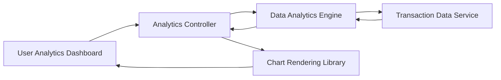

#### 1. High-Level Design

- **Summary:** This epic provides interactive visualizations and analytics to help users understand spending patterns across 9 categories (Food & Dining, Fuel, Shopping, Travel, Entertainment, Utilities, Healthcare, Education, Miscellaneous). Users can view monthly trends, category-wise breakdowns, and identify spending patterns over time with historical data support for at least 12 months.

- **Component Flow:**

- **Integration Points:**
  - **Upstream:** Transaction data service (for categorized transaction history)
  - **Upstream:** Data analytics engine (for processing and aggregating spending data)
  - **External Library:** Chart rendering library (for interactive visualizations)

- **Key Assumptions:**
  - Transactions are pre-categorized by the transaction data service or categorization logic exists upstream; historical data retained for minimum 12 months.
  - Chart rendering uses a responsive JavaScript library (e.g., Chart.js, D3.js) supporting touch gestures.

- **NFR Highlights:** Analytics visualizations load within 3 seconds; support 12+ months historical data; responsive charts with touch gesture support on mobile.

- **Data Flow:** User accesses analytics dashboard → Analytics Controller requests data from Transaction Data Service → Service retrieves categorized transactions → Data Analytics Engine aggregates spending by category and time period → Aggregated data returned to Controller → Chart Rendering Library generates interactive visualizations (bar charts, pie charts, line graphs) → User views spending insights and can interact with charts to drill down into specific categories or time periods.

#### 2. Validation Report

- **Requirements Coverage:** The design comprehensively covers category-wise spending visualization, monthly trend analysis, interactive charts, spending pattern identification, 9-category support, transaction categorization display, and card-wise spend analysis. All NFRs (3-second load time, 12-month history, responsive touch-enabled charts) are addressed through analytics engine optimization and responsive chart library selection. Dependencies on transaction data service, analytics engine, and chart library are integrated into the architecture.