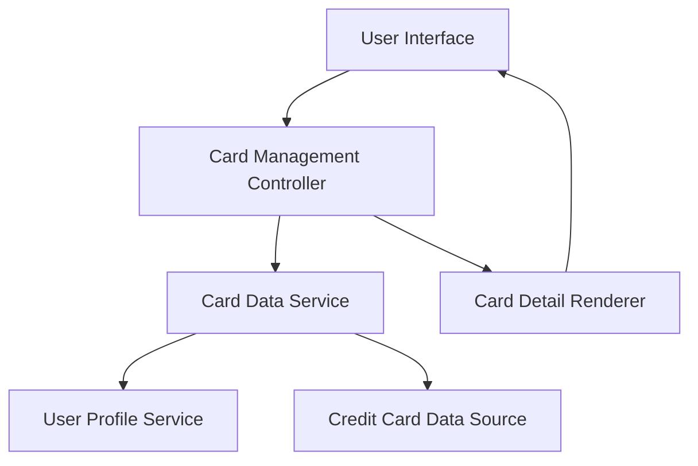

#### 1. High-Level Design

- **Summary:** This epic enables users to view and manage multiple credit cards (up to 10+) within a single interface. Users can see all cards with individual details, track card-specific metrics, and switch between cards to view detailed information, providing a unified multi-card monitoring experience.

- **Component Flow:**

- **Integration Points:**
  - **Upstream:** Credit card data source (for card details and metadata)
  - **Upstream:** User profile service (for associating cards with user accounts)
  - **Internal:** Card selection and navigation logic

- **Key Assumptions:**
  - Card numbers are stored securely with encryption and displayed masked (e.g., **** **** **** 1234); card metadata includes card type, issuer, expiry, and limits.
  - Card switching uses client-side caching to meet <500ms response time requirement.

- **NFR Highlights:** Support ≥10 cards per user; card switching response time <500ms; secure storage with masked card numbers.

- **Data Flow:** User logs in → Card Management Controller retrieves user profile from User Profile Service → Card Data Service fetches all associated cards from Credit Card Data Source → Cards displayed in list/grid view → User selects a card → Controller fetches card-specific metrics → Card Detail Renderer displays individual card information including spend, limit, and transactions.

#### 2. Validation Report

- **Requirements Coverage:** The design addresses all scope items: multiple card display, individual card detail views, card-wise spend analysis, card selection/navigation, card information management, and card-specific metrics. NFRs for supporting 10+ cards, <500ms switching, and secure masked display are incorporated through caching strategy and security layer. Dependencies on credit card data source and user profile service are integrated.