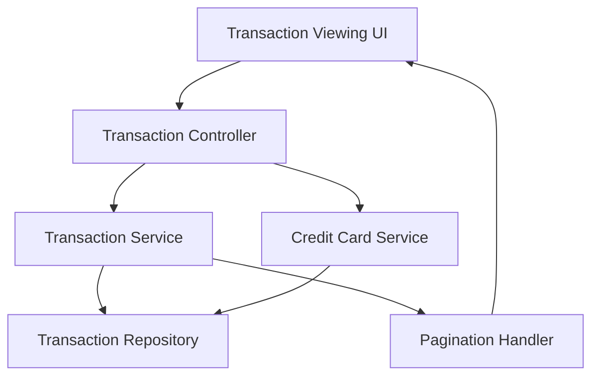

#### 1. High-Level Design

- **Summary:** This epic enables users to view and access their credit card transaction history across all registered cards. Users can browse transactions to understand spending patterns, verify purchases, and maintain financial records. The feature supports filtering and organization for quick transaction lookup.

- **Component Flow:**

- **Integration Points:**
  - **Upstream:** Transaction data service or repository for retrieving transaction records
  - **Downstream:** Credit card data integration for linking transactions to specific cards
  - **Internal:** Pagination or lazy loading handler for managing large transaction datasets

- **Key Assumptions:**
  - Transaction data includes essential details (date, amount, merchant, category, card identifier) in a consistent format for display.
  - Transactions are sorted by date (most recent first) by default, with filtering capabilities provided by the transaction service.

- **NFR Highlights:** Transaction data must be displayed accurately; interface must support pagination or lazy loading for large transaction sets; responsive design must maintain usability across all device sizes.

- **Data Flow:** User navigates to transaction view → Transaction controller requests transaction data from transaction service → Transaction service retrieves records from repository and links them to specific credit cards via credit card service → Pagination handler manages data loading (initial page load or lazy loading) → Transaction UI displays transaction list with relevant details (date, merchant, amount, card) → User can scroll/paginate to view additional transactions and apply filters for quick lookup.

#### 2. Validation Report

- **Requirements Coverage:** The design fully addresses the epic's scope including transaction listing, transaction history view, multi-card transaction support, transaction display with relevant details, and responsive transaction interface. The architecture supports all NFRs (accurate data display, pagination/lazy loading for large datasets, responsive design) through dedicated components for transaction retrieval, card linking, pagination, and UI rendering. All dependencies (transaction data service, credit card data integration) are incorporated into the component flow.