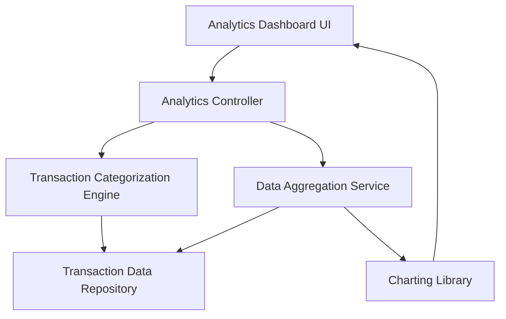

#### 1. High-Level Design

- **Summary:** This epic provides interactive visualizations and analytical insights into user spending patterns across 9 predefined categories (Food & Dining, Fuel, Shopping, Travel, Entertainment, Utilities, Healthcare, Education, Miscellaneous). It includes monthly spend trend analysis and card-wise spend analysis to enable data-driven financial decisions.

- **Component Flow:**

- **Integration Points:**
  - **Upstream:** Transaction categorization engine or service for classifying transactions into predefined categories
  - **Downstream:** Data aggregation service for calculating spending totals by category, month, and card
  - **External:** Charting library or visualization framework (e.g., Chart.js, D3.js) for rendering interactive charts and graphs

- **Key Assumptions:**
  - Transactions are pre-categorized or categorization rules are defined (e.g., merchant codes, keywords) to map transactions to the 9 predefined categories.
  - Monthly spend trends are calculated based on transaction dates, assuming transaction timestamps are accurate and available.

- **NFR Highlights:** Analytics visualizations must render within 3 seconds; charts must be interactive and responsive across devices; system must accurately categorize and aggregate spending data; support concurrent analysis across multiple time periods.

- **Data Flow:** User accesses analytics dashboard → Analytics controller retrieves transaction data from repository → Transaction categorization engine classifies transactions into 9 predefined categories → Data aggregation service calculates category-wise, monthly, and card-wise spending totals → Charting library renders interactive visualizations (bar charts, pie charts, line graphs) → User interacts with charts to explore spending patterns and trends.

#### 2. Validation Report

- **Requirements Coverage:** The design comprehensively addresses the epic's scope including category-wise spending visualization, monthly spend trends analysis, card-wise spend analysis, interactive charts, spending pattern identification across 9 categories, and responsive analytics interface. The architecture supports all NFRs (3-second render time, interactivity, responsiveness, accurate categorization, concurrent analysis) through dedicated components for categorization, aggregation, and visualization. All dependencies (transaction categorization engine, data aggregation service, charting library) are integrated into the component flow.