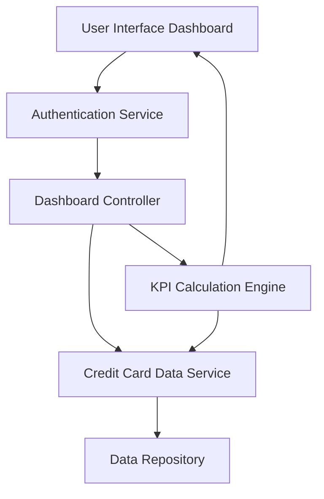

#### 1. High-Level Design

- **Summary:** This epic delivers a consolidated dashboard that displays real-time KPIs for multiple credit cards, including monthly spend, total credit limit, available credit, and outstanding amounts. The dashboard provides users with a unified financial snapshot to support informed credit card usage decisions.

- **Component Flow:**

- **Integration Points:**
  - **Upstream:** User authentication service for secure access control
  - **Downstream:** Credit card data source or mock data service for retrieving card details and financial metrics
  - **Internal:** KPI calculation engine for aggregating credit limit, available credit, and outstanding amounts

- **Key Assumptions:**
  - Credit card data is provided in a standardized format (JSON/XML) with consistent field mappings for card details and financial metrics.
  - KPI updates occur at regular intervals (e.g., near real-time or batch updates every few minutes) to meet the 2-second load requirement.

- **NFR Highlights:** Dashboard must load within 2 seconds; support responsive design for desktop and mobile; handle real-time data updates; ensure data accuracy for all financial calculations.

- **Data Flow:** User authenticates → Dashboard controller fetches credit card data from data repository → KPI calculation engine aggregates monthly spend, total credit limit, available credit, and outstanding amounts across all cards → Calculated KPIs are rendered on the dashboard UI → Dashboard updates in near real-time as new data becomes available.

#### 2. Validation Report

- **Requirements Coverage:** The design fully covers the epic's stated scope including dashboard KPIs display, multiple credit card view, monthly spend tracking, credit limit aggregation, available credit calculation, outstanding amount display, and responsive layout. The architecture supports all NFRs (2-second load time, responsive design, real-time updates, data accuracy) through dedicated components for authentication, data retrieval, KPI calculation, and UI rendering. All dependencies (credit card data source, authentication service) are addressed in the component flow.