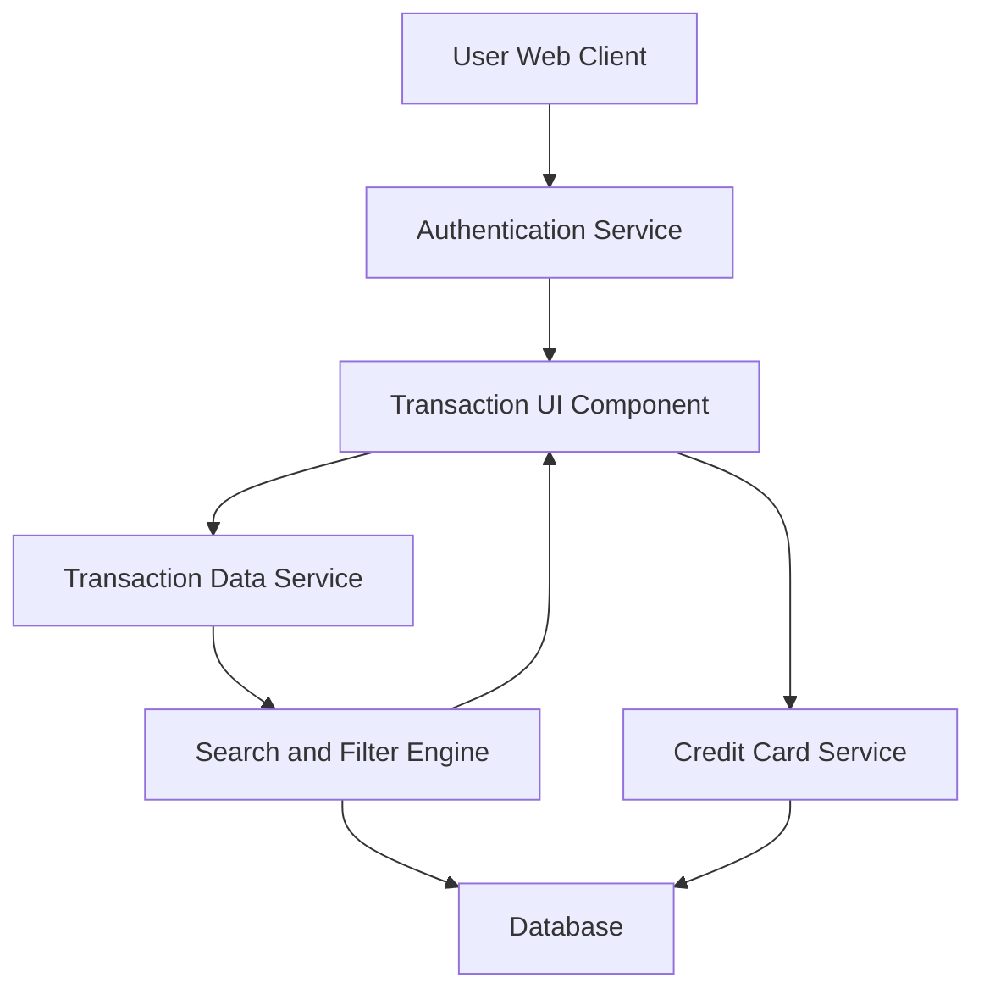

#### 1. High-Level Design

- **Summary:** This epic enables users to view, search, and analyze all credit card transactions across multiple cards. Users can access detailed transaction histories with filtering capabilities by card, date range, and transaction type. The system supports efficient handling of large transaction volumes (up to 10,000 per user) through pagination and optimized queries.

- **Component Flow:**

- **Integration Points:**
  - **Upstream:** User Authentication Service (for secure transaction access), Credit Card Service (to map transactions to specific cards)
  - **Downstream:** Transaction Data Service (for retrieving transaction records)

- **Key Assumptions:**
  - Transaction data is indexed by user, card, date, and type for efficient query performance
  - Pagination is implemented with configurable page size (e.g., 50-100 transactions per page)

- **NFR Highlights:** System must handle up to 10,000 transactions per user efficiently; transaction queries must return results within 500ms; data must be paginated for optimal performance

- **Data Flow:** User authenticates via Authentication Service → Transaction UI requests transaction list from Transaction Data Service with optional filters (card, date range, type) → Search and Filter Engine queries Database with pagination and filtering criteria → Credit Card Service provides card mapping data → Filtered and paginated transaction records are returned to Transaction UI → UI displays transaction listing with details, search, and filter controls → User interactions (search, filter, pagination) trigger new queries without full page reload

#### 2. Validation Report

- **Requirements Coverage:** The design fully addresses the epic's scope including transaction listing and display, multi-card transaction view, transaction details view, transaction search and filtering, date range selection, and responsive transaction interface. All NFRs (handling 10,000 transactions efficiently, 500ms query response time, pagination) are incorporated through the Search and Filter Engine and pagination strategy. Dependencies on Transaction Data Service, Credit Card Service, and User Authentication Service are explicitly integrated into the architecture. The design supports scalability and performance requirements for large transaction volumes.