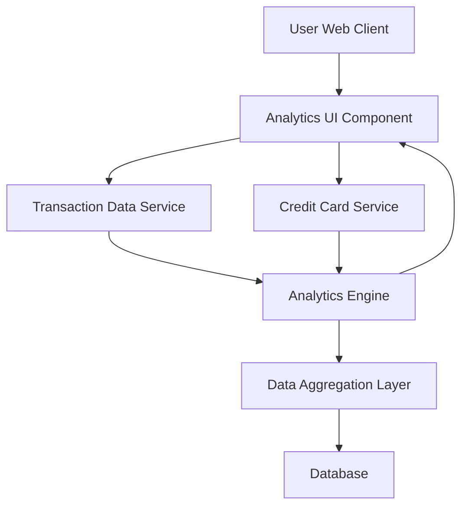

#### 1. High-Level Design

- **Summary:** This epic provides interactive spending analytics and visualization capabilities that enable users to understand spending patterns through category-wise analysis (Food & Dining, Fuel, Shopping, Travel, Entertainment, Utilities, Healthcare, Education, Miscellaneous) and monthly trend analysis. Users can analyze spending by card and identify patterns through interactive charts and graphs.

- **Component Flow:**

- **Integration Points:**
  - **Upstream:** Transaction Data Service (for spending data aggregation), Credit Card Service (for card-wise spend breakdown)
  - **Downstream:** Analytics Engine (for data processing and categorization)

- **Key Assumptions:**
  - Transactions are pre-categorized or categorization logic exists in the Analytics Engine based on merchant codes or transaction descriptions
  - Monthly trend data is aggregated and stored for performance optimization

- **NFR Highlights:** Analytics visualizations must render within 1 second; system must support interactive filtering without page reload; charts must be responsive and accessible across all device sizes

- **Data Flow:** User accesses Analytics UI → UI requests transaction data from Transaction Data Service and card data from Credit Card Service → Analytics Engine processes and categorizes transactions into predefined categories → Data Aggregation Layer computes category-wise totals, monthly trends, and card-wise breakdowns from Database → Processed analytics data is returned to Analytics UI → Interactive charts and graphs render spending patterns, trends, and insights for user interaction

#### 2. Validation Report

- **Requirements Coverage:** The design comprehensively covers all scope elements including category-wise spending visualization (9 predefined categories), monthly spend trends analysis, card-wise spend analysis, interactive charts and graphs, spending pattern identification, multi-category support, and responsive analytics interface. All NFRs (1-second render time, interactive filtering without reload, responsive charts) are addressed through the Analytics Engine and UI architecture. Dependencies on Transaction Data Service, Analytics Engine, and Credit Card Service are fully integrated into the component flow.