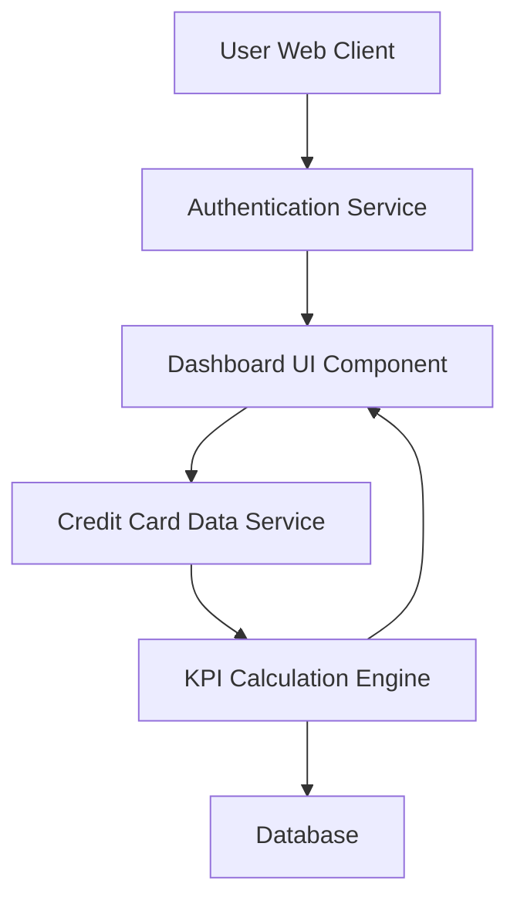

#### 1. High-Level Design

- **Summary:** This epic delivers a consolidated credit card portfolio dashboard that displays key performance indicators including monthly spend, total credit limit, available credit, and outstanding amounts. The dashboard provides users with real-time visibility into their overall credit card financial health across multiple cards through a modern, responsive interface.

- **Component Flow:**

- **Integration Points:**
  - **Upstream:** User Authentication Service (for secure user session and access control)
  - **Downstream:** Credit Card Data Service (for retrieving card details, balances, limits, and outstanding amounts)

- **Key Assumptions:**
  - KPI data is assumed to be refreshed in near real-time (within acceptable latency) from the Credit Card Data Service
  - Card data format follows a standardized schema with fields for limit, balance, available credit, and monthly spend

- **NFR Highlights:** Dashboard must be responsive across desktop, tablet, and mobile devices; page load time under 2 seconds; real-time data refresh for KPI metrics

- **Data Flow:** User authenticates via Authentication Service → Dashboard UI requests card portfolio data from Credit Card Data Service → Service retrieves card details and balances from Database → KPI Calculation Engine aggregates data (total spend, total limit, available credit, outstanding amounts) → Calculated KPIs are returned to Dashboard UI → Dashboard renders responsive KPI visualizations for user

#### 2. Validation Report

- **Requirements Coverage:** The design fully covers the epic's stated scope including dashboard KPI display, monthly spend tracking, total credit limit visualization, available credit calculation, outstanding amount display, multiple credit cards view, and responsive layout. All NFRs (responsiveness, 2-second load time, real-time refresh) are addressed through component architecture and integration with Credit Card Data Service. Dependencies on Credit Card Data Service and User Authentication Service are explicitly incorporated into the design.