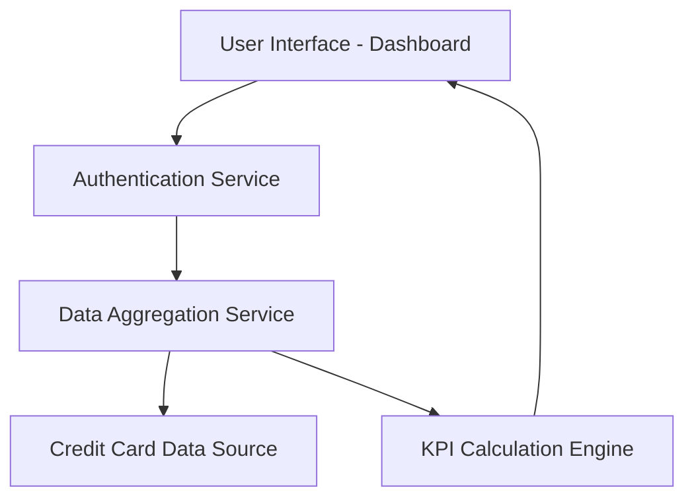

#### 1. High-Level Design

- **Summary:** This epic delivers a consolidated dashboard that aggregates and displays key performance indicators across all user credit cards. The core requirement is to provide a single-pane view of critical financial metrics including monthly spend, total credit limit, available credit, and outstanding amounts, enabling users to monitor their overall credit position and make informed financial decisions.

- **Component Flow:**

- **Integration Points:** 
  - **Upstream:** Credit card data source (provides raw credit card account data and transaction data)
  - **Upstream:** User authentication service (validates user identity and access permissions)
  - **Internal:** Data aggregation service (consolidates data from multiple credit card accounts)

- **Key Assumptions:** 
  - Credit card data is refreshed in near real-time or at regular intervals (e.g., every 15-30 minutes) to support the 2-second load requirement.
  - All credit card accounts are linked to a single user profile, and the system has read access to all associated card data.

- **NFR Highlights:** Dashboard must load within 2 seconds; must support responsive layouts across desktop and mobile devices; data must be displayed accurately with real-time synchronization.

- **Data Flow:** User authenticates through the authentication service, which validates credentials and establishes a session. The dashboard UI requests aggregated data from the data aggregation service, which queries the credit card data source for all linked accounts. The KPI calculation engine processes raw data to compute monthly spend, total credit limit, available credit, and outstanding amounts. Calculated KPIs are returned to the UI and rendered within the 2-second performance requirement. The dashboard displays consolidated metrics across all credit cards in a responsive layout optimized for both desktop and mobile devices.

#### 2. Validation Report

- **Requirements Coverage:** The design fully covers the epic's stated scope including dashboard KPI display, monthly spend tracking, total credit limit aggregation, available credit calculation, outstanding amount monitoring, multiple credit card management, and consolidated credit card view. The architecture addresses all NFRs (2-second load time, responsive design, real-time synchronization) through dedicated components (data aggregation service, KPI calculation engine). All specified dependencies (credit card data source, user authentication service, data aggregation service) are integrated into the component flow. The design explicitly excludes out-of-scope items (real bank integration, card payments, fund transfers, loans, payment gateway integration) by focusing solely on read-only dashboard display capabilities.