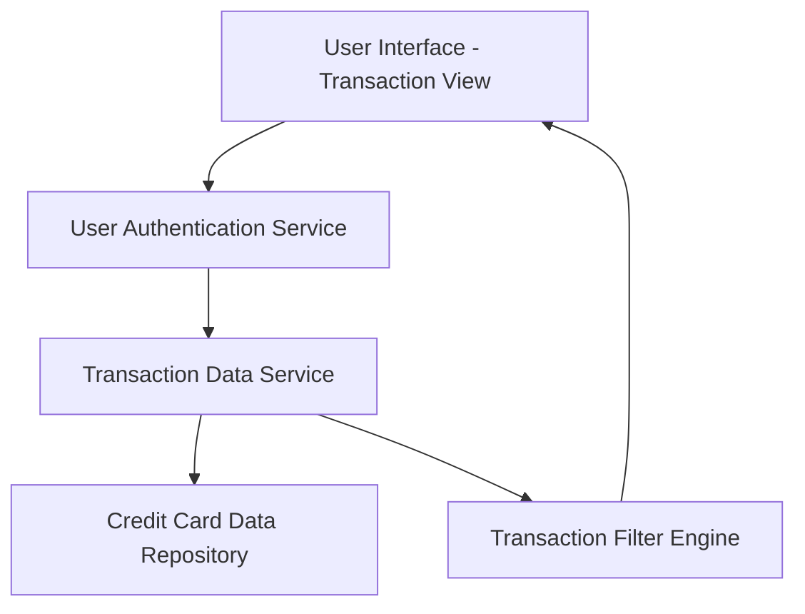

#### 1. High-Level Design

- **Summary:** This epic provides a unified transaction management interface that enables users to view, monitor, and review all credit card transactions across multiple cards. The core requirement is to deliver comprehensive transaction history access with detailed transaction information, supporting financial awareness, spending oversight, and fraud detection through a single consolidated view.

- **Component Flow:**

- **Integration Points:** 
  - **Upstream:** Transaction data service (provides transaction records and details)
  - **Upstream:** Credit card data repository (stores historical transaction data across all cards)
  - **Upstream:** User authentication service (validates user identity and authorizes transaction access)

- **Key Assumptions:** 
  - Transaction data includes standard fields such as timestamp, amount, merchant name, category, and card identifier.
  - The system supports pagination or lazy loading to handle high volumes of transaction records efficiently without performance degradation.

- **NFR Highlights:** Transaction data must be displayed with accurate timestamps and amounts; system must handle high volume of transaction records efficiently; interface must maintain responsive design across all devices.

- **Data Flow:** User authenticates through the authentication service to establish authorized access to transaction data. The transaction view UI requests transaction data from the transaction data service, which queries the credit card data repository for all transactions associated with the user's linked cards. The transaction filter engine applies any user-specified filters (e.g., filter by specific card, date range, or amount) to the result set. Filtered transaction data is returned to the UI with accurate timestamps and amounts, displayed in a responsive interface that efficiently handles high volumes through pagination or incremental loading. Users can drill down into individual transactions to view detailed information including merchant details, transaction category, and card used.

#### 2. Validation Report

- **Requirements Coverage:** The design comprehensively covers the epic's stated scope including transaction listing, transaction details view, multi-card transaction aggregation, transaction history access, and transaction filtering by card. The architecture addresses all NFRs through dedicated components: accurate timestamp and amount display via the transaction data service, high-volume handling through the transaction filter engine with pagination support, and responsive design through the UI layer. All specified dependencies (transaction data service, credit card data repository, user authentication service) are integrated into the component flow. The design explicitly excludes out-of-scope items (real bank integration, card payments, fund transfers, payment gateway integration, transaction disputes) by focusing on read-only transaction viewing and monitoring capabilities without any transactional or dispute management features.