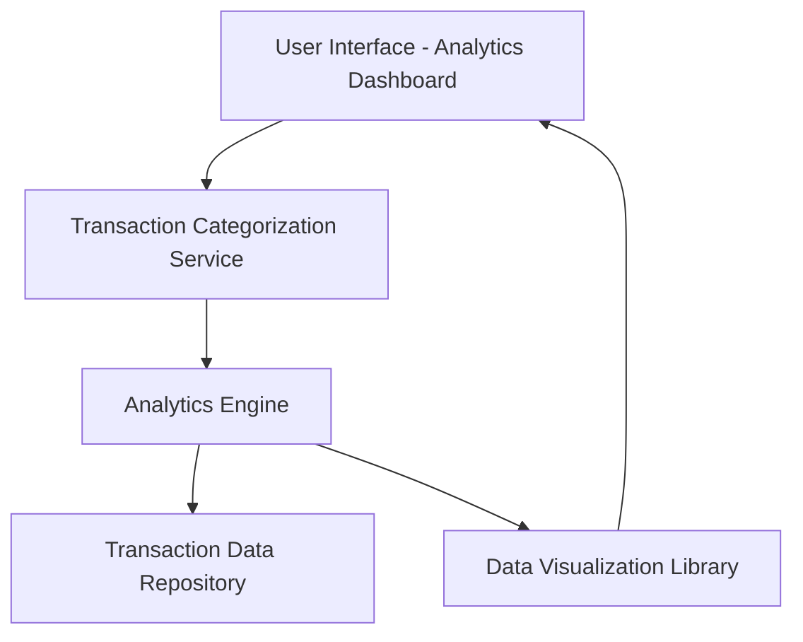

#### 1. High-Level Design

- **Summary:** This epic delivers an interactive analytics platform that enables users to understand spending patterns through category-wise analysis, monthly trends, and card-wise comparisons. The core requirement is to provide visual analytics across nine predefined spending categories (Food & Dining, Fuel, Shopping, Travel, Entertainment, Utilities, Healthcare, Education, Miscellaneous) with interactive filtering and drill-down capabilities, empowering users to make data-driven budgeting decisions.

- **Component Flow:**

- **Integration Points:** 
  - **Upstream:** Transaction categorization service (classifies transactions into predefined spending categories)
  - **Upstream:** Transaction data repository (provides historical transaction data for analysis)
  - **Internal:** Analytics engine (processes transaction data to generate spending insights and trends)
  - **Internal:** Data visualization library (renders interactive charts and graphs)

- **Key Assumptions:** 
  - Transaction categorization is performed automatically using merchant codes or transaction descriptions, with a fallback to "Miscellaneous" for uncategorized transactions.
  - Monthly trends are calculated based on calendar months, and the system retains at least 12 months of historical data for trend analysis.

- **NFR Highlights:** Visualizations must render within 3 seconds; analytics must support interactive filtering and drill-down capabilities; charts and graphs must be responsive and accessible across all device types.

- **Data Flow:** User accesses the analytics dashboard, which requests categorized transaction data from the transaction categorization service. The categorization service retrieves raw transactions from the transaction data repository and applies classification logic to assign each transaction to one of nine predefined categories. The analytics engine processes categorized data to compute category-wise spending totals, monthly spend trends, and card-wise spend analysis. Processed analytics data is passed to the data visualization library, which renders interactive charts and graphs (e.g., pie charts for category distribution, line charts for monthly trends, bar charts for card-wise comparison). Visualizations render within 3 seconds and support interactive filtering (e.g., filter by date range, specific card, or category) and drill-down capabilities (e.g., click on a category to view underlying transactions). The responsive UI ensures charts and graphs adapt to desktop and mobile device screens while maintaining accessibility standards.

#### 2. Validation Report

- **Requirements Coverage:** The design fully addresses the epic's stated scope including category-wise spending analysis, monthly spend trends visualization, card-wise spend analysis, interactive data visualizations, spending pattern identification, and multi-category tracking across all nine specified categories (Food & Dining, Fuel, Shopping, Travel, Entertainment, Utilities, Healthcare, Education, Miscellaneous). The architecture addresses all NFRs through dedicated components: 3-second visualization rendering via the data visualization library, interactive filtering and drill-down through the analytics engine, and responsive/accessible design through the UI layer. All specified dependencies (transaction categorization service, analytics engine, data visualization library, transaction data repository) are integrated into the component flow. The design explicitly excludes out-of-scope items (real bank integration, predictive analytics, budget recommendations, automated alerts, third-party financial tool integrations) by focusing solely on descriptive analytics and visualization of historical spending patterns without predictive or prescriptive capabilities.