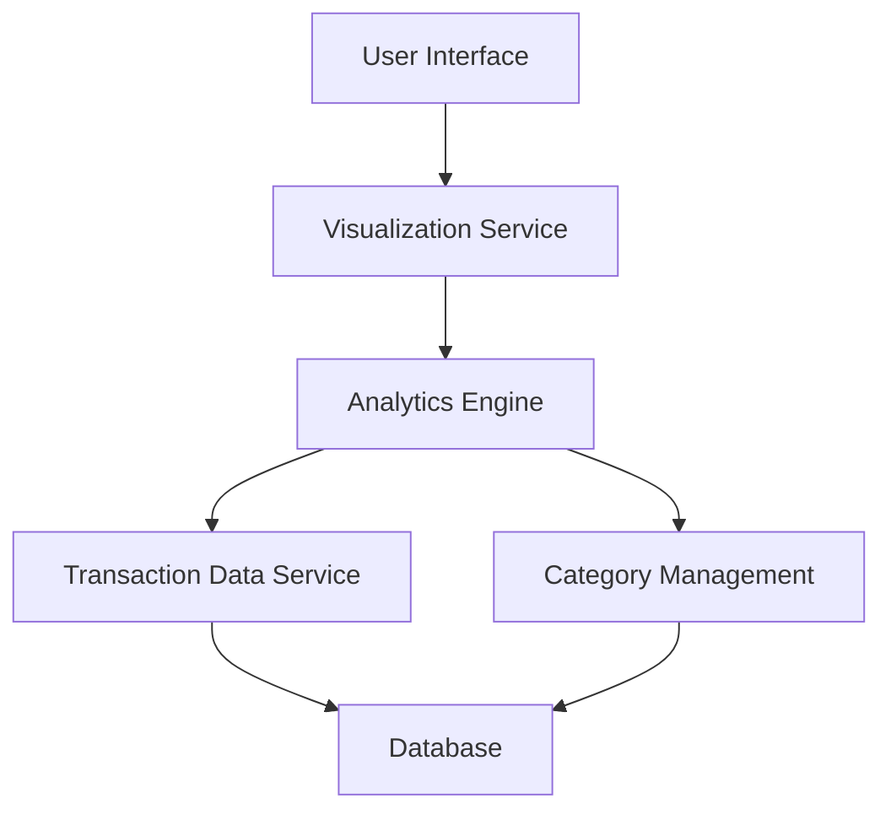

#### 1. High-Level Design

- **Summary:** This epic implements an interactive analytics and visualization platform that enables users to analyze spending patterns across nine predefined categories (Food & Dining, Fuel, Shopping, Travel, Entertainment, Utilities, Healthcare, Education, Miscellaneous). The solution provides visual representations including interactive charts and graphs with drill-down capabilities to support data-driven financial decision-making.

- **Component Flow:**

- **Integration Points:**
  - **Upstream:** Transaction Data Service (provides categorized transaction history for analysis)
  - **Upstream:** Analytics Engine (processes and aggregates spending data by category)
  - **Upstream:** Category Management (maintains category definitions and transaction-category mappings)
  - **Downstream:** Visualization Service (renders interactive charts and graphs)

- **Key Assumptions:**
  - Transactions are pre-categorized or auto-categorized into the nine predefined categories at ingestion time.
  - Analytics Engine supports aggregation and filtering operations required for category-wise analysis.

- **NFR Highlights:** Visualizations render within 1 second; handles up to 10,000 transactions per user; charts support interactive drill-down capabilities.

- **Data Flow:** User accesses spending analytics through UI → Visualization Service requests category-wise spending data → Analytics Engine queries Transaction Data Service for categorized transactions → Category Management provides category definitions and mappings → Analytics Engine aggregates spending by category (Food & Dining, Fuel, Shopping, Travel, Entertainment, Utilities, Healthcare, Education, Miscellaneous) → Processed data returned to Visualization Service → Interactive charts/graphs rendered in UI with drill-down support → User explores spending patterns and identifies high-expense categories.

#### 2. Validation Report

- **Requirements Coverage:** The design fully satisfies the epic's scope including category-wise spending visualization, interactive charts and graphs, spending pattern analysis, and multi-category tracking across all nine specified categories. All NFRs (<1s render time, 10K transaction support, interactive drill-down) are architecturally supported. Required integrations with transaction data service and analytics engine are clearly defined and aligned with the stated dependencies.