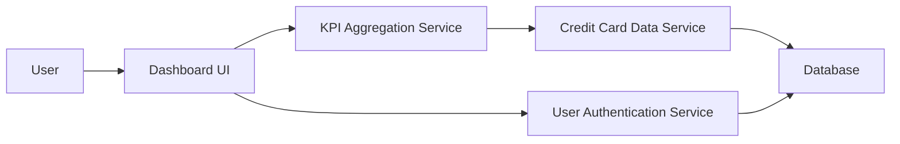

#### 1. High-Level Design

- **Summary:** This epic creates a consolidated dashboard that aggregates and displays critical financial KPIs across all user credit cards in a single, responsive interface. The dashboard provides real-time visibility into monthly spend, total credit limits, available credit, and outstanding balances, enabling users to monitor their credit card portfolio health at a glance.

- **Component Flow:**

- **Integration Points:**
  - **Upstream:** Credit Card Data Service (provides card details, balances, credit limits, and outstanding amounts)
  - **Upstream:** User Authentication Service (ensures secure access to user-specific credit card data)
  - **Downstream:** Dashboard UI (renders KPIs and multi-card overview)

- **Key Assumptions:**
  - Credit card data is refreshed in near real-time or at defined intervals by the Credit Card Data Service.
  - User authentication tokens are valid and securely managed for session-based access.

- **NFR Highlights:** Dashboard responsive across mobile/tablet/desktop; page load under 2 seconds; supports real-time data refresh for KPIs.

- **Data Flow:** User authenticates via User Authentication Service → Dashboard UI requests KPI data → KPI Aggregation Service queries Credit Card Data Service for all user cards → Service retrieves card details, balances, limits, and outstanding amounts from Database → Aggregated KPIs (monthly spend, total credit limit, available credit, outstanding amounts) are calculated → Data returned to Dashboard UI → User views consolidated multi-card KPI dashboard with real-time refresh capability.

#### 2. Validation Report

- **Requirements Coverage:** The design comprehensively addresses all stated requirements including dashboard KPI display, monthly spend tracking, credit limit aggregation, available credit calculation, outstanding amount display, multiple credit card view, and responsive layout. All NFRs (responsive design, <2s load time, real-time refresh) are supported through the architecture. Required integrations with credit card data service and authentication service are properly identified and mapped.