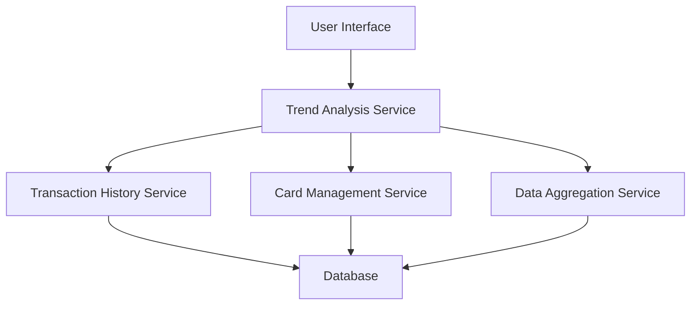

#### 1. High-Level Design

- **Summary:** This epic delivers a comprehensive monthly spending trend analysis system that enables users to track and compare spending patterns over time across multiple credit cards. The solution provides historical spending data visualization, card-wise spending breakdowns, and month-over-month trend analysis to help users optimize credit utilization and maintain budget control.

- **Component Flow:**

- **Integration Points:**
  - **Upstream:** Transaction History Service (provides time-series transaction data for trend analysis)
  - **Upstream:** Card Management Service (provides individual credit card details and metadata)
  - **Upstream:** Data Aggregation Service (provides monthly rollup data and historical summaries)
  - **Downstream:** User Interface (consumes trend data and visualizations)

- **Key Assumptions:**
  - Transaction data is pre-categorized and stored with accurate timestamps for monthly aggregation.
  - Card ownership and user-card associations are maintained by the Card Management Service.

- **NFR Highlights:** System must maintain 12+ months historical data; trend calculations complete within 500ms; supports up to 20 credit cards per user concurrently.

- **Data Flow:** User requests monthly spending trends through the UI → Trend Analysis Service retrieves historical transaction data from Transaction History Service → Card Management Service provides card details → Data Aggregation Service computes monthly rollups and spending distributions → Aggregated trend data (monthly totals, card-wise breakdowns, MoM comparisons) is returned to UI → User views interactive trend visualizations and card-specific spending patterns.

#### 2. Validation Report

- **Requirements Coverage:** The design fully covers the epic's stated scope including monthly spend trend visualization, card-wise spend analysis, historical spending comparison, credit card usage distribution, and trend identification. All NFRs (12-month history retention, 500ms calculation performance, 20-card support) are addressed through the architecture. Integration dependencies with transaction history, card management, and data aggregation services are explicitly mapped.