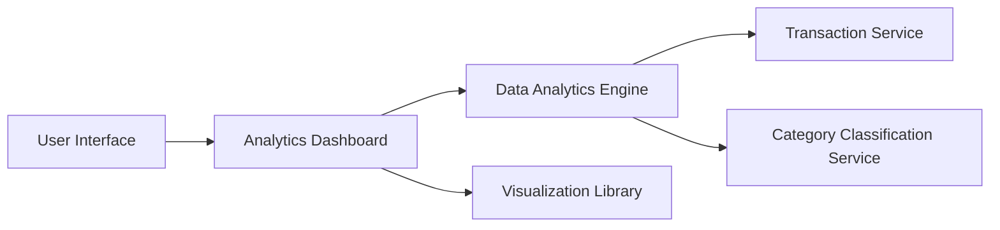

#### 1. High-Level Design

- **Summary:** This epic provides users with analytics and visualization capabilities to understand spending patterns across predefined categories (Food & Dining, Fuel, Shopping, Travel, Entertainment, Utilities, Healthcare, Education, Miscellaneous) and time periods. Users can access interactive visualizations showing category-wise spending breakdowns, monthly spend trend analysis, and card-wise spend analysis through intuitive charts and graphs.

- **Component Flow:**

- **Integration Points:**
  - **Upstream:** Transaction Service (retrieves transaction data and amounts)
  - **Downstream:** Category Classification Service (automatic transaction categorization), Data Analytics Engine (trend calculations and aggregations), Visualization Library (renders interactive charts)

- **Key Assumptions:** 
  - Transactions are automatically categorized by the Category Classification Service with 99% accuracy as specified in NFRs.
  - Historical data is retained for at least 12 months to support trend analysis.

- **NFR Highlights:** Analytics visualizations render within 3 seconds; support historical data analysis for minimum 12 months; responsive interactive charts with touch gesture support on mobile; 99% transaction categorization accuracy.

- **Data Flow:** User accesses the Analytics Dashboard via the UI. The dashboard requests spending analytics from the Data Analytics Engine. The engine retrieves transaction data from Transaction Service and categorization metadata from Category Classification Service. Transactions are aggregated by category (Food & Dining, Fuel, Shopping, Travel, Entertainment, Utilities, Healthcare, Education, Miscellaneous) and time period. The aggregated data is processed to generate monthly spend trends and card-wise spend analysis. Results are returned to the Analytics Dashboard, which uses the Visualization Library to render interactive charts and graphs showing category-wise spending breakdowns, time-based comparisons, and trend analysis.

#### 2. Validation Report

- **Requirements Coverage:** The design fully addresses the epic's scope including category-wise spending visualization, monthly spend trend analysis, interactive charts and graphs, spending breakdown by predefined categories, time-based spending comparisons, card-wise spend analysis, and transaction categorization. All NFRs (3-second rendering, 12-month historical data, responsive interactive charts with touch support, 99% categorization accuracy) are incorporated into the architecture. Integration dependencies with Transaction Service, Category Classification Service, Data Analytics Engine, and Visualization Library are clearly defined and mapped.