#### 1. High-Level Design

- **Summary:** This epic delivers a consolidated dashboard that displays key performance indicators (KPIs) for all user credit cards in a unified interface. The dashboard aggregates monthly spending, total credit limits, available credit, and outstanding amounts across all cards, providing real-time visibility into the user's credit card financial health through a responsive, accessible UI.

- **Component Flow:**

```mermaid
flowchart TD
    A["User Browser/Mobile App"]
    B["Dashboard UI Component"]
    C["KPI Aggregation Service"]
    D["Credit Card Data Service"]
    E["Transaction Service"]
    F["User Authentication Service"]
    A --> B
    B --> C
    C --> D
    C --> E
    B --> F
    F --> C
```

- **Integration Points:**
  - **Upstream:** User Authentication Service (for secure user session and access control)
  - **Downstream:** Credit Card Data Service (retrieves card details, limits, and balances), Transaction Service (calculates monthly spend and outstanding amounts)

- **Key Assumptions:** 
  - Data is refreshed in near real-time (assumed polling interval or push mechanism not specified).
  - KPI calculations are performed server-side by the aggregation service rather than client-side.

- **NFR Highlights:** Dashboard must load within 2 seconds; responsive design across desktop, tablet, and mobile; WCAG 2.1 accessibility compliance; real-time data refresh capability.

- **Data Flow:** User authenticates via User Authentication Service. Dashboard UI requests aggregated KPI data from KPI Aggregation Service. The aggregation service fetches card details (limits, balances) from Credit Card Data Service and transaction data (monthly spend, outstanding amounts) from Transaction Service. Aggregated KPIs are computed and returned to the Dashboard UI, which renders the consolidated view with monthly spending, total credit limit, available credit, and outstanding amounts across all cards.

#### 2. Validation Report

- **Requirements Coverage:** The design fully addresses the epic's stated scope including dashboard KPI display, monthly spend calculation, credit limit aggregation, available credit computation, outstanding amount tracking, responsive UI design, and multi-card consolidated view. All NFRs (2-second load time, responsive design, WCAG 2.1 compliance, real-time refresh) are accounted for in the architecture. Integration dependencies with Credit Card Data Service, Transaction Service, and User Authentication Service are clearly mapped.