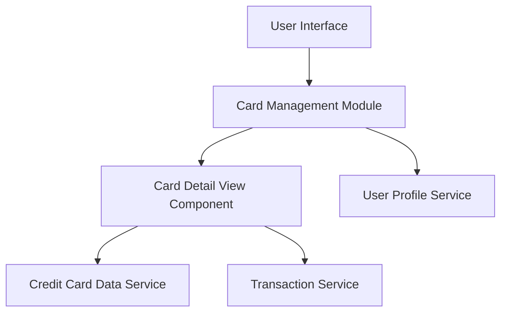

#### 1. High-Level Design

- **Summary:** This epic enables users to manage and view multiple credit cards within the dashboard. Users can view all registered cards with individual card details including card-specific credit limits, available credit, and outstanding balances. The feature provides comprehensive card-wise financial summaries and supports easy navigation between cards.

- **Component Flow:**

- **Integration Points:**
  - **Upstream:** User Profile Service (links cards to user accounts)
  - **Downstream:** Credit Card Data Service (card registration and details), Transaction Service (card-specific transaction history and balances)

- **Key Assumptions:** 
  - Card data is retrieved on-demand per card view (assumed lazy loading or batch retrieval not specified).
  - Card numbers are masked using a standard format (e.g., last 4 digits visible).

- **NFR Highlights:** System must support minimum 10 credit cards per user; card data retrieval within 1 second per card; data synchronization consistency across all card views; secure storage with masked card numbers.

- **Data Flow:** User accesses the Card Management Module via the UI. The module retrieves the list of user's registered cards from User Profile Service. When a user selects a specific card, the Card Detail View Component fetches card-specific details (credit limit, available credit) from Credit Card Data Service and outstanding balance from Transaction Service. Individual card summaries are displayed with masked card numbers, and users can navigate between multiple cards to view card-wise financial information.

#### 2. Validation Report

- **Requirements Coverage:** The design comprehensively covers the epic's scope including multiple credit card display, individual card detail views, card-wise credit limit display, card-specific available credit calculation, outstanding balance tracking, card identification and labeling, and card-wise spend analysis. All NFRs (minimum 10 cards support, 1-second retrieval per card, data synchronization, secure masked display) are addressed. Integration dependencies with Credit Card Data Service, User Profile Service, and Transaction Service are properly identified and mapped.