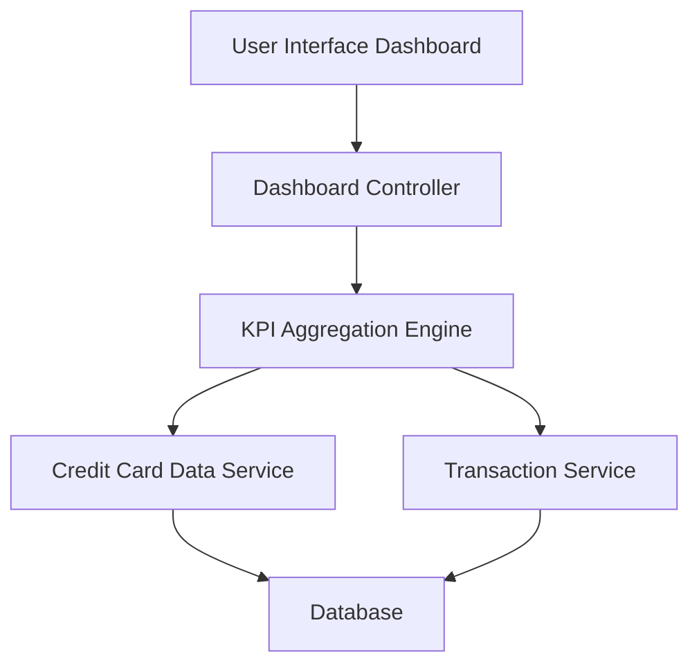

#### 1. High-Level Design

- **Summary:** This epic delivers a centralized dashboard interface that consolidates critical financial KPIs across all credit cards, including monthly spend, total credit limit, available credit, and outstanding amounts. The dashboard provides users with a single-pane-of-glass view to assess their overall credit card financial health and make informed spending decisions.

- **Component Flow:**

- **Integration Points:** 
  - **Upstream:** Credit Card Data Service (for card balances and limits), Transaction Service (for monthly spend and outstanding amounts calculation)
  - **Downstream:** Dashboard UI (responsive web and mobile interfaces)

- **Key Assumptions:** 
  - Data refresh occurs at regular intervals (assumed real-time means near real-time with acceptable latency up to 2 seconds)
  - Outstanding amounts are calculated as sum of unpaid transactions from Transaction Service

- **NFR Highlights:** Dashboard must load within 2 seconds, support responsive design across desktop and mobile devices, handle real-time data refresh for KPI updates

#### 2. Validation Report

- **Requirements Coverage:** The design fully covers the epic's stated scope by incorporating all required KPIs (monthly spend, total credit limit, available credit, outstanding amounts) through integration with Credit Card Data Service and Transaction Service. The component flow ensures data aggregation and presentation within the specified 2-second load time constraint. The responsive dashboard layout requirement is addressed through the UI layer design supporting both desktop and mobile devices.