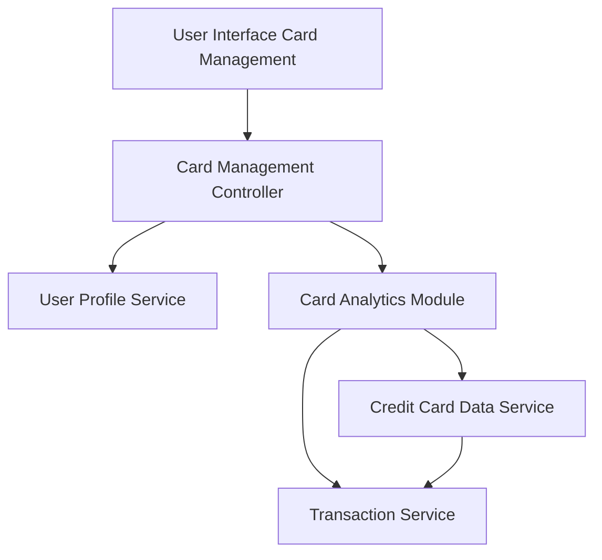

#### 1. High-Level Design

- **Summary:** This epic enables comprehensive multi-card management capabilities, allowing users to view, track, and analyze multiple credit cards within a unified interface. It provides card-specific spending patterns, balance tracking, credit limit monitoring, and transaction history to help users optimize credit utilization across their card portfolio.

- **Component Flow:**

- **Integration Points:** 
  - **Upstream:** User Profile Service (for card ownership validation), Credit Card Data Service (for card details and limits), Transaction Service (for card-specific transaction history)
  - **Downstream:** Card Management UI (multi-card display interface)

- **Key Assumptions:** 
  - Card ownership validation occurs at session initialization and is cached for performance
  - Card-wise spend analysis aggregates transactions by card ID with monthly granularity

- **NFR Highlights:** System must support viewing and managing at least 10 credit cards per user, card data synchronization must occur within 3 seconds, interface must be responsive across all device types

#### 2. Validation Report

- **Requirements Coverage:** The design addresses all functional requirements including multiple credit card display, card-wise spend analysis, individual card balance tracking, and transaction listing per card. Integration with User Profile Service ensures proper card ownership validation, while Credit Card Data Service and Transaction Service provide necessary data for card-specific insights. The Card Analytics Module aggregates data to support the 10-card minimum requirement and 3-second synchronization NFR. The responsive interface requirement is incorporated into the UI layer design.