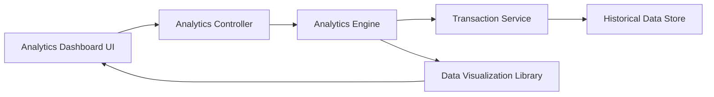

#### 1. High-Level Design

- **Summary:** This epic delivers interactive analytics and visualization capabilities that enable users to understand spending patterns across nine predefined categories (Food & Dining, Fuel, Shopping, Travel, Entertainment, Utilities, Healthcare, Education, Miscellaneous). It provides monthly spend trends and category-wise breakdowns to support data-driven financial decision-making.

- **Component Flow:**

- **Integration Points:** 
  - **Upstream:** Transaction Service (for categorized transaction data), Analytics Engine (for aggregating and computing spending patterns)
  - **Downstream:** Data Visualization Library (for rendering charts and graphs), Analytics Dashboard UI (for interactive visualizations)

- **Key Assumptions:** 
  - Transactions are pre-categorized by Transaction Service into the nine defined categories
  - Historical data retention supports 12 months of transaction history for trend analysis

- **NFR Highlights:** Analytics visualizations must render within 1.5 seconds, support interactive filtering and drill-down capabilities, handle up to 12 months of historical transaction data for trend analysis

#### 2. Validation Report

- **Requirements Coverage:** The design comprehensively covers all requirements including category-wise spending visualization across all nine specified categories, monthly spend trend charts, and interactive analytics dashboard. The Analytics Engine aggregates data from the Transaction Service to compute spending patterns, while the Data Visualization Library handles rendering within the 1.5-second performance constraint. The architecture supports interactive filtering and drill-down capabilities through the Analytics Controller and handles the 12-month historical data requirement via the Historical Data Store. All stated scope elements are addressed in the component flow.