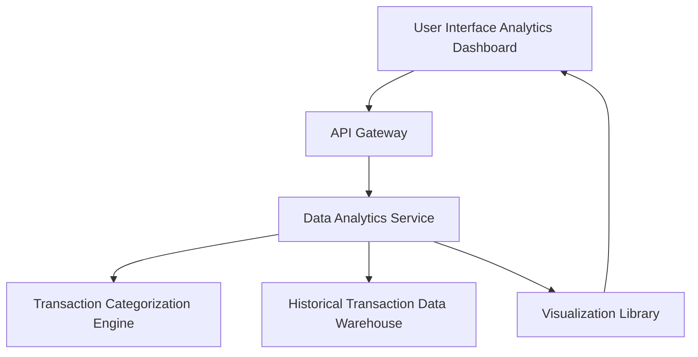

#### 1. High-Level Design

- **Summary:** This epic provides interactive analytics and visualization capabilities to help users understand spending behavior through category-wise analysis (9 predefined categories: Food & Dining, Fuel, Shopping, Travel, Entertainment, Utilities, Healthcare, Education, Miscellaneous) and monthly trend tracking over 12 months. The core requirement is to deliver actionable insights through visual analytics that enable data-driven financial decisions.

- **Component Flow:**

- **Integration Points:**
  - **Upstream:** Transaction categorization engine (category assignment), Historical transaction data warehouse (transaction history storage), Visualization library (chart rendering)
  - **Downstream:** User interface analytics dashboard (interactive visualizations)

- **NFR Highlights:** Analytics queries execute within 3 seconds; support up to 12 months historical data; smooth chart rendering on all devices; handle 3000 concurrent analytics requests

- **Data Flow:** User accesses analytics dashboard → API Gateway routes request to Data Analytics Service → Service queries Historical Transaction Data Warehouse for user's transaction history (up to 12 months) → Transaction Categorization Engine assigns or retrieves category tags for transactions across 9 predefined categories → Data Analytics Service aggregates spending by category and time period → Visualization Library generates interactive charts (category-wise spending, monthly trends) → Analytics dashboard renders visualizations with drill-down capabilities → User explores spending patterns, compares time periods, and analyzes category-level insights.

#### 2. Validation Report

- **Requirements Coverage:** The design fully addresses the epic's scope including category-wise spending visualization across 9 categories, monthly spend trend charts, interactive analytics dashboard, spending pattern analysis, time-based comparisons, and drill-down capabilities. All NFRs (3-second query execution, 12-month historical data support, smooth rendering, 3000 concurrent users) are supported through optimized data warehouse queries, efficient categorization engine, and scalable analytics service. Dependencies on transaction categorization engine, data analytics service, historical transaction data warehouse, and visualization library are explicitly integrated in the component flow.