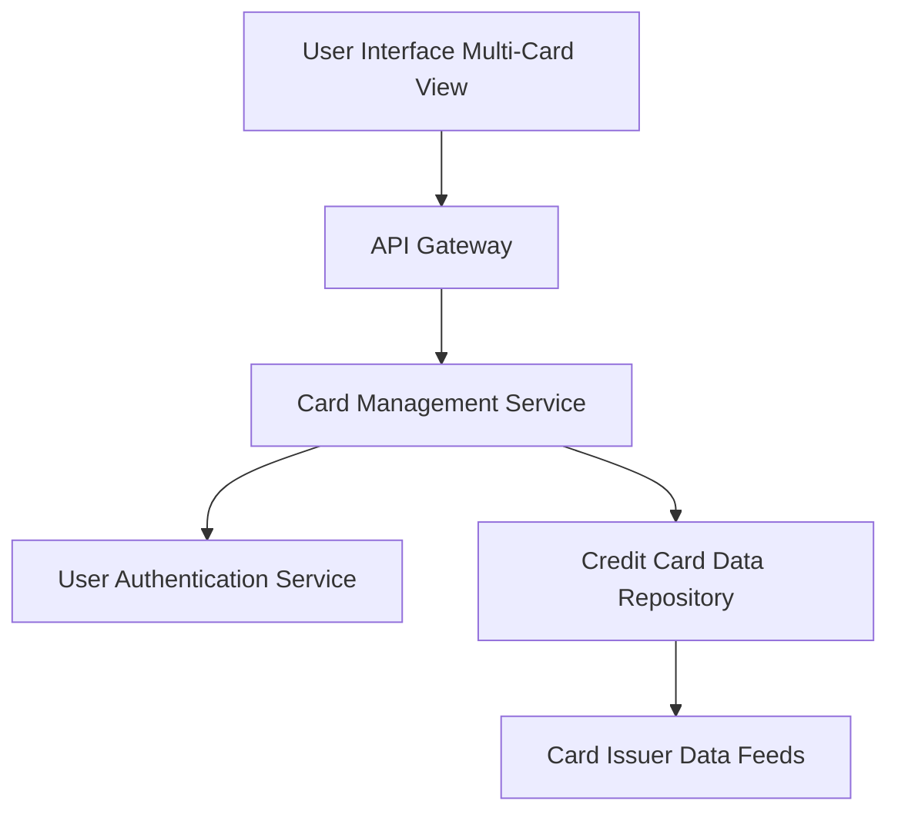

#### 1. High-Level Design

- **Summary:** This epic enables users to manage and monitor multiple credit cards (minimum 10 per user) through a unified interface. The core requirement is to provide consolidated card listing, card-specific details, card-wise spend analysis, and comparison capabilities, eliminating the need for users to access multiple banking portals.

- **Component Flow:**

- **Integration Points:**
  - **Upstream:** Credit card data repository (card information storage), User authentication service (card ownership validation), Card issuer data feeds (card information updates)
  - **Downstream:** User interface layer (multi-card display and filtering)

- **Key Assumptions:**
  - Card data is synchronized periodically from card issuer feeds (assuming daily or hourly sync)
  - Card-wise spend analysis aggregates transactions by card identifier

- **NFR Highlights:** Support minimum 10 cards per user; card data retrieval < 1 second; support 5000 concurrent users; consistent data synchronization across cards

- **Data Flow:** User logs in and requests card portfolio view → API Gateway authenticates via User Authentication Service → Card Management Service retrieves all cards owned by user from Credit Card Data Repository → For each card, service fetches latest data from Card Issuer Data Feeds → Card-wise spend analysis is calculated by aggregating transactions per card → Consolidated multi-card view with individual card details, balances, and spend analysis is returned to UI → User can filter, compare, and drill down into specific cards.

#### 2. Validation Report

- **Requirements Coverage:** The design comprehensively covers the epic's scope including multiple credit card display, card-wise spend analysis, individual card details, card-specific balance tracking, card comparison, and card selection/filtering. NFRs for supporting 10+ cards per user, sub-1-second retrieval, 5000 concurrent users, and consistent synchronization are addressed through scalable service architecture and data repository design. All dependencies (credit card data repository, user authentication service, card issuer data feeds) are integrated in the component flow.